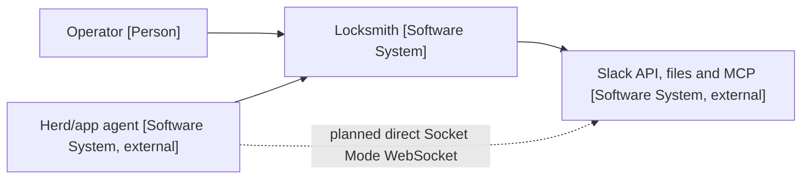
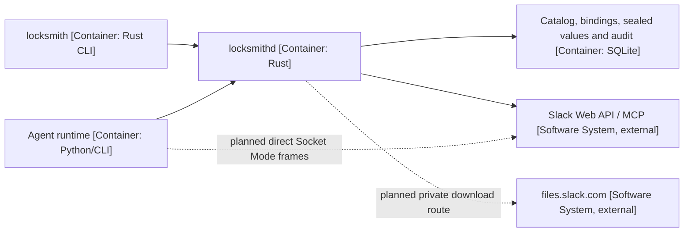
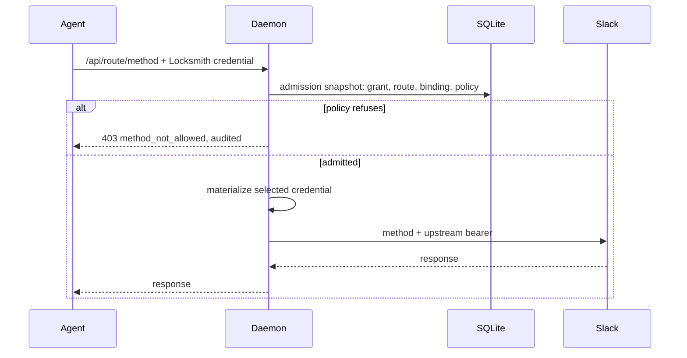

# Slack through Locksmith

## 1 Introduction and goals

Keep Slack credentials in Locksmith while giving each agent an explicit account
and method policy. Credential custody, workspace correctness and per-identity
revocation take priority over convenience. Operators own setup; herd agents act
as John; app agents retain their bot identities. This document covers the built
primitives and the accepted deployment boundaries, not a completed rollout.

## 2 Constraints

The first workspace is WeModulate on staging edge Locksmith, port 9300. The site
still describes build `e7c006d`; the newer policy and workspace primitives exist
on this feature branch, not thereby on staging. See the site edge README and
[ADR-0003](../adr/0003-slack-route-and-binding.md). Live posts and agent cutovers
remain attended. Tokens and client secrets use stdin/authenticated bodies;
agent bearer files belong outside repositories with mode 0600.

## 3 Context and scope

Locksmith authenticates an agent and substitutes the selected upstream
credential. Slack retains control of scopes, membership and account identity.
Socket Mode frames are a deliberate direct connection in the target design.

## 4 Solution strategy

Separate the workspace route from the selected account and method policy to
avoid treating a workspace as a posting identity. Validate a sealed Web API
bearer before custody, then enforce binding policy before dispatch. Existing
MCP OAuth profiles retain their combined workspace/user assertion. ADR-0003
records the reasons and the incomplete shared-route contract.

## 5 Building block view

The existing CLI, daemon and SQLite store implement these primitives. No new
service is introduced. Dashed paths are accepted deployment work still pending.

### 5.1 Ownership

The route owns upstream and immutable `metadata.slack_team_id`. A binding owns
account selection and optional method policy. The credential store owns sealed
values; the agent owns only its Locksmith credential. SQLite joins policy,
binding and grants in the request admission snapshot
(`src/registrations/admission.rs:64`). The existing broker branch requires an
explicit broker selection and sends the route key; it cannot simultaneously
serve app stored-bearer selections (`src/proxy/admission.rs:96`).

### 5.2 Interfaces

These are the built contracts; target deployment paths are identified explicitly.

| Interface | Contract and source |
|---|---|
| Web API route | `/api/<route>/<method>`; method refusal is 403 `method_not_allowed` before credential dispatch (`src/proxy/admission.rs:60`) |
| Workspace ingestion | `--slack-team-id` declares `metadata.slack_team_id`; route/per-agent sealed bearer PUT checks `auth.test`; mismatch 400 `slack_workspace_mismatch`, verification failure 502 `slack_workspace_check_failed` (`src/registrations/slack_workspace.rs:54`) |
| Binding policy | Optional allow/deny strings; deny wins; literal methods only, no encoded aliases or separators (`src/method_policy.rs:19`); [CLI flags and API](../reference/cli-reference.md#upstream-method-policy) |
| Backend switch | 409 `backend_method_policy_present` if any route binding has a policy; checked before mutation inside the switch transaction (`src/registrations/backends.rs:438`); [ADR-0004](../adr/0004-refuse-backend-switch-with-policy.md) |
| Account selection | Broker sends route key; ordinary stored bearer materializes only selected source (`src/proxy/admission.rs:84`, `src/proxy/selection.rs:60`) |
| MCP account | Fixed `slack-confidential-v1` scope and workspace/user checks (`src/oauth/consent/slack.rs:8`, `src/oauth/consent/slack_identity.rs:19`); [operator contract](../operator/slack-oauth.md) |
| Socket setup, planned | Separate route for `apps.connections.open` with app-level credential, then direct WebSocket; existing matrix HTTP check in layer8-proxy-site `edge/evo-x2-1/locksmith/route_matrix.py:59` |
| File downloads, planned | Separate `files.slack.com` route with bot credential; F-011 must map approved private URLs and keep bearer credentials on their intended hop |

## 6 Runtime view

Ingestion checks workspace before sealing and compares persisted route state
inside the write transaction. A refusal preserves the prior key; the detailed
flow is in [workspace ingestion](slack-workspace-architecture.md).

The accepted app flow obtains a Socket Mode URL through the separate route, then
opens a direct WebSocket. Private file requests instead traverse the file route.
Neither path has been cut over by this documentation entry.

Backend switching and policy writes serialize through SQLite `BEGIN IMMEDIATE`.
A switch checks for any policy before stashing or deleting bindings and refuses
without mutation when one exists. Operators must explicitly clear policies before
switching, then reapply destination policies. Credential-only stashes cannot carry
method policies; refusal avoids restoring a restricted binding unrestricted.

## 7 Deployment view

The staging site is in layer8-proxy-site `edge/evo-x2-1/locksmith/`; the README
links the decision. Its current deployment pin predates F-001/F-002. Deploying
those binaries, provisioning accounts, admitting app addresses and changing
runtimes are later entries. Production edge cutover is separate. Hermes at the
pinned revision still constructs its own token-bearing Slack client
(`plugins/platforms/slack/adapter.py:1728` in hermes-agent).

## 8 Crosscutting concepts

Custody does not grant authority. Agents need current grants, an explicit
selection and policy; Slack also applies its own permissions. No policy means
unrestricted methods, so the participant policy must be provisioned explicitly.
It does not restrict message content or channels. Audit attributes refused and
accepted requests to the Locksmith identity, not necessarily the displayed Slack
author (`src/proxy/admission.rs:64`). Direct WebSocket frames bypass that audit.

Workspace checking covers sealed bearer ingestion only, not env/1Password or
OAuth references. OAuth performs its own workspace/user verification. The
verifier bounds provider responses and avoids reflecting their text
(`src/registrations/slack_workspace.rs:35`). Never retain WebSocket URLs, private
content or credential values in rollout evidence.

## 9 Architecture decisions

These accepted decisions separate implementation mechanics from rollout topology.

| ADR | Status |
|---|---|
| [0001: binding method policy](../adr/0001-binding-method-policy.md) | Accepted, implemented |
| [0002: workspace ingestion](../adr/0002-slack-workspace-ingestion.md) | Accepted, implemented |
| [0003: Slack route and binding](../adr/0003-slack-route-and-binding.md) | Accepted, rollout incomplete |
| [0004: refuse switching with policies](../adr/0004-refuse-backend-switch-with-policy.md) | Accepted, implemented |

## 10 Quality requirements

The quality tree has three priorities: custody (no upstream credential in an
agent), authorization (workspace and method correctness), and operability (live
updates and per-VM revocation). A wrong-workspace replacement must preserve the usable prior key. An unlisted
or denied method must produce zero upstream dispatch. Policy and key changes
must affect the next admitted call without a restart. The lasting real-daemon
checks are `qa/smoke/test_cat_slack_workspace.py` and
`qa/smoke/test_agt_method_policy.py`; they establish these local contracts, not
live Slack eligibility. User-visible cutovers must also prove posting identity,
receive behavior and scheduled posts in attended checks.
`qa/smoke/test_rte_backends.py::test_switch_refuses_binding_method_policy`
checks refusal on both legs of a backend round trip, unchanged revision and
zero upstream dispatch for denied methods.

## 11 Risks and technical debt

The current broker-only contract blocks the intended mixed identity route.
Resolve it before shared route onboarding; do not infer support from the two
individually supported credential mechanisms. The built-in MCP profile's two
scopes cannot meet full private/DM participation; live custom-contract acceptance
is unknown. The current Hermes adapter retains Slack tokens and direct private
file downloads (`plugins/platforms/slack/adapter.py:6402` in hermes-agent).
Direct Socket Mode traffic exposes a transient capability to the runtime and
bypasses Locksmith frame audit. Acting as John permits reading his private
content and posting as him, accepted at spec sign-off.

Not yet documented: exact deployed workspace/account fingerprints, per-VM
provisioning, custom MCP acceptance results, adapter configuration, agent cutover
and rollback procedures. These require later entries and live evidence.

## 12 Glossary

A **workspace** is Slack's `team_id`. A **route** identifies an upstream and its
expected workspace. A **binding** selects an agent's account and method policy.
**Socket Mode** receives events over a WebSocket obtained with an app-level
token. **MCP** is the Model Context Protocol; its OAuth account and finite tool
grants are separate from Web API method policy.
