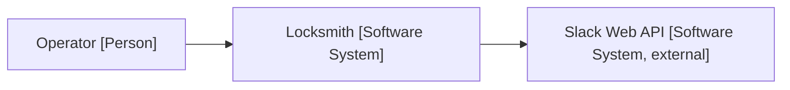
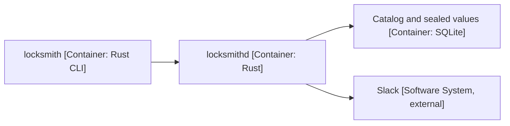
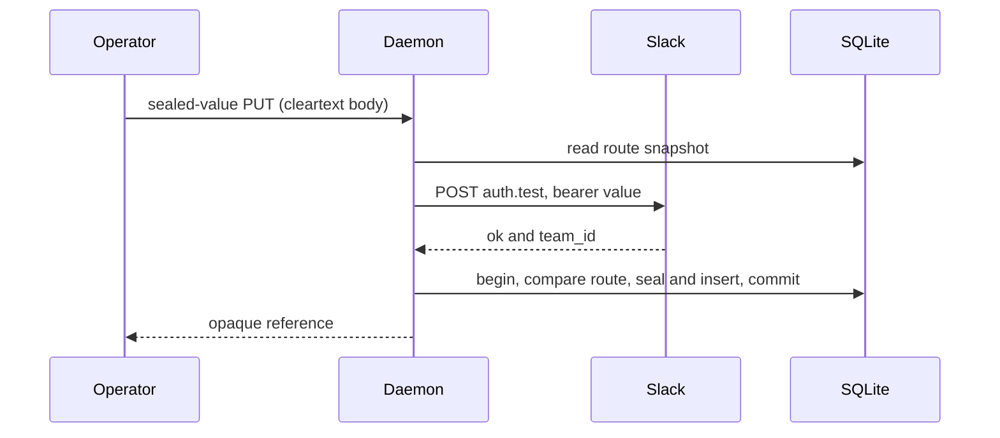

# Slack workspace credential ingestion

## 1 Introduction and goals

A declared Slack route accepts only sealed tokens whose `auth.test` reports its
workspace. Preserve existing credentials on refusal, keep secrets out of
diagnostics, and retain offline ingestion for other routes. Operators configure
the expectation; agents consume the resulting explicit binding.

## 2 Constraints

The existing daemon, SQLite catalog and sealing key own this flow. Tokens arrive
on stdin or the authenticated operator API, never argv. The declaration applies
to HTTP tools and bearer credentials (`src/registrations/slack_workspace.rs:26`).

## 3 Context and scope

The operator is trusted to name the upstream. Slack replies are untrusted data.
This view covers token ingestion, not the complete Slack rollout.

## 4 Solution strategy

Check before sealing to avoid accepting a wrong-workspace credential. Freeze the
expectation so a later metadata edit cannot silently redefine already accepted
keys. Use existing egress/TLS construction to preserve deployment policy.
[ADR-0002](../adr/0002-slack-workspace-ingestion.md) records the tradeoffs.

## 5 Building block view

The daemon owns both validation and persistence; no additional service is added.

### 5.1 Ownership

The route owns `metadata.slack_team_id`. Route keys and per-agent keys retain
their existing storage and selection ownership. Cleartext is transient; only a
successful check reaches the credential sealing writer.

### 5.2 Interfaces

The existing operator PUT route accepts `metadata.slack_team_id` and the CLI
provides `--slack-team-id`. Both credential-value PUT paths invoke the same verifier
(`src/registrations/api.rs:832`, `src/admin/stored_credential.rs:63`). A successful
check requires HTTP success, `ok:true` and an exact team id. Refusals use
`slack_workspace_mismatch` (400) or `slack_workspace_check_failed` (502), described
in the [CLI reference](../reference/cli-reference.md#slack-workspace-check).

Stored-reference selection refuses with 400
`slack_workspace_selection_unsupported`; explicit stored references in route PUT
refuse as `invalid_metadata`. Backend credential writes and all switches refuse
with 409 `slack_workspace_backend_unsupported`, including old backend keys and
stashed bindings. Repository writer transactions own these checks; only checked
value ingestion can attach a stored token. Broker key retention keeps its existing
key/destination comparison. See [ADR-0005](../adr/0005-slack-unverified-credential-paths.md)
and the CLI reference for the complete path inventory.

## 6 Runtime view

The transaction compares the checked route with current persisted state. A
changed snapshot refuses the write; it never silently validates one destination
and attaches the value to another.

Failure before commit preserves the previous selection. Route writes reuse the
existing atomic comparison (`src/registrations/credential.rs:39`); per-agent
writes compare under `BEGIN IMMEDIATE` (`src/admin/stored_credential.rs:176`).

## 7 Deployment view

No listener or schema migration changes. The verifier uses the daemon's config
and the route's egress and CA settings. Unconfigured egress fails closed through
the existing client builder (`src/registrations/slack_workspace.rs:88`).

## 8 Crosscutting concepts

Provider text never becomes an error message. Team ids have a bounded uppercase
alphabet; replies are capped at 16 KiB with a five-second request timeout
(`src/registrations/slack_workspace.rs:19`, `src/registrations/slack_workspace.rs:101`).
Redirects and retries are disabled by the existing client policy. No HTTP
request is added to the ordinary proxy path.

## 9 Architecture decisions

The governing decision is [ADR-0002: Check Slack workspace before sealing a
token](../adr/0002-slack-workspace-ingestion.md), Accepted.

[ADR-0005](../adr/0005-slack-unverified-credential-paths.md), Accepted, records
refusal of unchecked reference and backend paths.

## 10 Quality requirements

The lasting real-daemon smoke covers acceptance and live rotation, first-write
and replacement mismatches, hostile/oversized replies, redirects, immutable
metadata, unchanged offline ingestion and a concurrent route edit
(`qa/smoke/test_cat_slack_workspace.py`). The prior key must remain selected on
refusal; the upstream receives no redirect or retry.

## 11 Risks and technical debt

Slack availability is required when accepting a declared token. Operators can
still name a non-Slack upstream; the metadata is not a destination allowlist.
Env/1Password references and OAuth bypass sealed-value ingestion and are not
verified by this check. Broker routes still require broker-only selections,
which needs resolution before sharing one route with app-specific stored keys.

Not yet documented here: MCP reads, OAuth consent, file and Socket Mode routes,
VM distribution and production cutovers. The broader [Slack architecture](slack-architecture.md)
and [ADR-0003](../adr/0003-slack-route-and-binding.md) record those boundaries.

## 12 Glossary

`team_id` identifies a Slack workspace. A route names the upstream and expected
workspace. A binding selects an agent's credential source. A sealed value is a
credential encrypted at rest by Locksmith.
