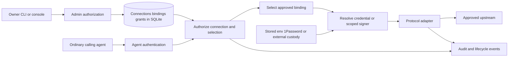

# HTTP integration boundaries

This public technical projection retains the shared contracts used by the finite
HTTP grant design. It is conceptual guidance, not a claim that every adapter,
pool, identity provider or deployment profile is implemented. The
[current HTTP contract](2026-10-21-explicit-http-grants.md) narrows these
principles to existing registration names, finite reviewed grants and explicit
account selections. In particular it promises connection-wide HTTP authority,
not operation-level policy or immediate stream cancellation.

## Outcome and fixed boundaries

An owner connects an approved upstream account once, grants selected agents access, and can change or revoke that access without distributing upstream secrets. Supported connector capabilities work for a reference vendor and an independently configured customer service.

- One daemon and SQLite per owner/security domain, with many agents. Shared multi-tenancy and its design are out of scope.
- Use existing local operator credentials and per-agent bearer-over-TLS; optional mTLS remains. Federated platform tokens and browser sign-in are deferred, with explicit instance entitlement required if later added.
- Owners control enabled definitions, configured connections, credential selection and agent grants.
- Network admission, mandatory routing and malicious-content/intent detection belong to the gateway/firewall. A tailnet is optional.
- Executable tools run in existing agent/platform executors; locksmith does not schedule agents, provision VMs or own browser profiles.
- Quota-aware accounts are early delivery work. Approval queues and upstream passkey automation are later; telemetry has lower priority.

## Composition and trust flow

These are modules/contracts, initially inside the existing daemon, not proposed microservices. The optional pool selector runs after authorization and before credential resolution. Separate credential-use processes/hosts are an optional stronger deployment profile, not prerequisites for the catalog.

## Minimum shared contracts

| Contract | Required meaning | First delivery boundary |
| --- | --- | --- |
| Principal | Stable local agent/operator identity, authentication source, and optional issuer/subject/actor attribution | Adapt existing identities; do not replace local auth or build an IdP |
| Connector definition | Versioned protocol/auth requirements and optional operation schema; no secret values | One HTTP definition; no general plugin loader or importer required |
| Connection | Stable ID, definition revision, approved destination, upstream account/environment and active generation | One configured HTTP endpoint/account; existing names become aliases |
| Credential binding | Connection/account, custody or token provider, opaque reference and relevant constraints | Existing stored/env/OAuth sources first; source access is operator-controlled |
| Grant | Agent, connection revision and approved credential selection; expiry and supported operation/resource selectors | Connection-level authority is explicit initially; unsupported narrower selectors fail validation rather than being ignored |
| Credential selection | Direct binding initially; later an explicitly approved set of eligible pool members | First project implements only direct selection; pool support is a later small extension |
| Credential lease | Resolved secret or restricted signing/injection capability, account identity and expiry/version when available | Internal request-time material; never returned through catalog or agent discovery |
| Admission context | Principal, grant/connection generations, selected binding/account and correlation ID | Captured for each admitted operation; adapters cannot choose another account |
| Adapter capability | Supported protocol modes, wire auth and policy selectors, cancellation/lifetime and outcome contract | Ordinary HTTP first; streaming/native modes are separately declared and tested |

This is the conceptual contract, not a requirement to introduce nine new tables or traits. Implement the minimum fields on existing paths. Keep custody, token acquisition/refresh, wire authentication and application protocol separate; add an interface when a second implementation needs it.

## Request and owner-change behavior

1. Authenticate the caller into an agent or operator principal. A human platform user is not automatically an agent or an operator.
2. Resolve the requested connection and check its active revision plus the agent's explicit grant. Deny before fetching a credential if access is absent, expired, disabled or inconsistent.
3. Select only a granted binding or eligible member of a granted pool. Validate account/destination compatibility; a caller-supplied secret reference is never an authorization input.
4. Require an explicit binding for credentialed use; absent selection denies. Shared accounts are named explicitly per allowed agent, never inherited at request time. Resolve/refresh that binding. Missing, empty, revoked or failed resolution must not fall back to another account or an unauthenticated request. An explicitly credential-free connection is a separate approved configuration.
5. Invoke the declared adapter with its scoped admission context. Strip caller attempts to override upstream auth. Redirect destinations must not inherit credentials outside the approved binding.
6. Record admission and outcome separately where a request/stream can outlive the initial response. Include selected account/reference IDs, never secret values or unrestricted payloads.

Start with SQLite-authoritative grant/binding reads at admission. Runtime caches must carry generations and reject a mismatch; benchmark before adding a distributed/cache-only authorization scheme. On owner revocation, the next newly admitted operation must be denied. Already-admitted HTTP calls may finish within their configured deadline. Long-lived session cancellation/rechecks must be designed and delivered with each streaming/native adapter; do not claim immediate termination before that support ships.

Distinguish persisted desired configuration from acknowledged active configuration. A failed cache/adapter activation must report pending/failed state and reject requests requiring that generation. It must not return an unqualified active-success response or serve a broader stale grant. Owner changes to destination, account or authority require explicit grant revision; ordinary token refresh within the same approved account does not.

## Migration and compatibility

1. Inventory existing registrations, overrides and OAuth labels; produce a dry-run mapping to stable connection/binding IDs and effective grants. Preserve stored secret references and account attribution.
2. Use additive schema changes and the existing admin/proxy route families. Existing names remain aliases; avoid a competing v-next proxy or a second authorization engine.
3. Explicitly review agents whose missing allowlist currently means unrestricted access. Migration captures owner-confirmed current connections as explicit grants; newly added entries must not silently expand access.
4. Migrate one opt-in connection/agent, verify allowed/denied requests and next-admission revocation, then expand. A rollback must restore the complete compatible binary/schema/config state; it must not silently re-enable revoked grants or resurrect an old account selection.
5. Define schema compatibility and backup/restore before publishing migrations. Do not promise an old binary can safely consume every new schema/config shape.
