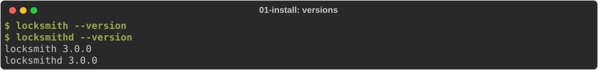
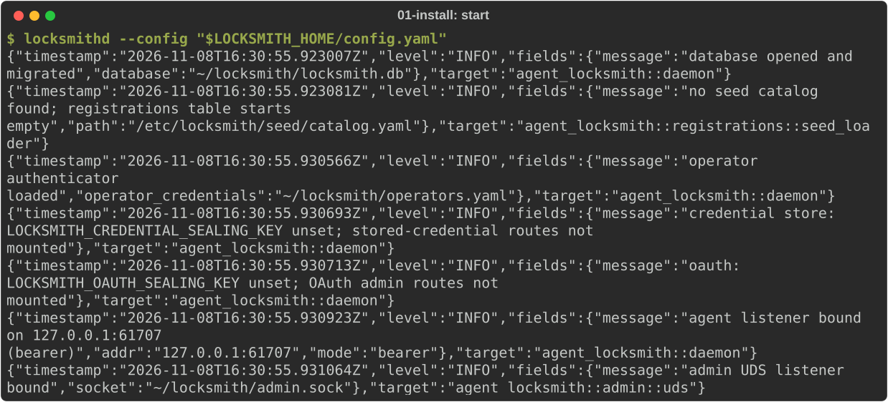
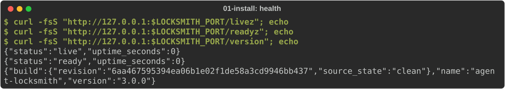
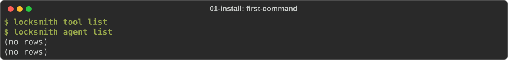
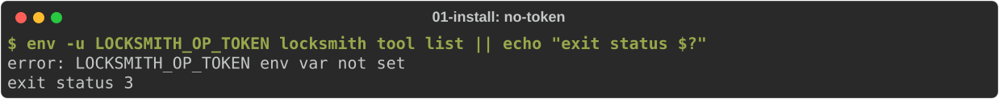

# Install and first run

You will install the two Locksmith programs, create an operator credential,
write a minimal configuration, start the daemon and check that it answers.
This takes about five minutes.

- `locksmithd` is the daemon. It serves agents on a TCP port and operators
  on a local admin socket.
- `locksmith` is the command-line client for operators and agents.

## Install the binaries

Download the release for your platform from the project's GitHub releases
and put both programs on your `PATH`, or build them from source with Rust
1.94.0:

```sh
cargo +1.94.0 build --locked --release --bins
export PATH="$PWD/target/release:$PATH"
```

Check that your shell finds both:

<!-- uat:step versions -->
```sh
locksmith --version
locksmithd --version
```



## Choose a home for this instance

Everything this instance owns lives in one private directory. Pick a free
port for agents (9200 here), tell the CLI where the admin socket will be, and
fix the ports of the services later journeys run beside Locksmith:

<!-- uat:step home -->
```sh
export LOCKSMITH_HOME="$HOME/locksmith"
export LOCKSMITH_PORT="${LOCKSMITH_PORT:-9200}"
export LOCKSMITH_SOCKET="$LOCKSMITH_HOME/admin.sock"
export BOOTSTRAP_PORT="${BOOTSTRAP_PORT:-9202}" REFERENCE_PORT="${REFERENCE_PORT:-9300}"
export MCP_PORT="${MCP_PORT:-9400}" CALLBACK_PORT="${CALLBACK_PORT:-9444}"
mkdir -p "$LOCKSMITH_HOME"
chmod 700 "$LOCKSMITH_HOME"
```

`LOCKSMITH_SOCKET` saves you passing `--socket` to every `locksmith` command.
The journeys run commands in more than one terminal. Run this block in every
terminal you open, so they all agree on the directory and the ports.

## Create an operator credential

Operators manage Locksmith through the admin socket with a bearer token.
`bootstrap-operator` mints one: the operators file it writes to stdout holds
only an Argon2 hash, and the token itself is printed once to stderr.

<!-- uat:step operator -->
```sh
umask 077
locksmith bootstrap-operator --name admin \
  > "$LOCKSMITH_HOME/operators.yaml" \
  2> "$LOCKSMITH_HOME/operator-token.txt"
eval "$(grep 'export LOCKSMITH_OP_TOKEN=' "$LOCKSMITH_HOME/operator-token.txt")"
test -n "$LOCKSMITH_OP_TOKEN" && echo "operator token loaded"
```

Keep the token somewhere safe, such as your password manager, then delete
`operator-token.txt`. Anyone holding it can manage this instance. To load it
in a new shell, `export LOCKSMITH_OP_TOKEN=...` again.

## Write the configuration

The daemon reads one YAML file at startup. This one serves agents on
loopback with bearer tokens, opens the admin socket, and keeps the database
in your home directory:

<!-- uat:step config -->
```sh
cat > "$LOCKSMITH_HOME/config.yaml" <<EOF
listen:
  host: "127.0.0.1"
  port: $LOCKSMITH_PORT
  auth_mode: bearer
  admin_socket:
    path: "$LOCKSMITH_HOME/admin.sock"
operator_credentials_path: "$LOCKSMITH_HOME/operators.yaml"
database:
  path: "$LOCKSMITH_HOME/locksmith.db"
tools: []
EOF
```

The catalog starts empty. Locksmith never reloads this file: after you edit
it, restart the daemon. Everything you add through the admin socket later
(services, agents, grants, credentials) is stored in the database and takes
effect immediately.

## Start the daemon

Run it in its own terminal and leave it running. It logs one JSON object per
line to stdout:

<!-- uat:step start bg -->
```sh
locksmithd --config "$LOCKSMITH_HOME/config.yaml"
```



If a packaged seed catalog exists at `/etc/locksmith/seed/catalog.yaml`, the
daemon imports it on first start. Set `LOCKSMITH_SEED_PATH=""` to skip it.

## Check that it answers

In another terminal (after running the [home block](#choose-a-home-for-this-instance)), ask the agent port
whether the daemon is alive and ready, and which version it runs:

<!-- uat:step health -->
```sh
curl -fsS "http://127.0.0.1:$LOCKSMITH_PORT/livez"; echo
curl -fsS "http://127.0.0.1:$LOCKSMITH_PORT/readyz"; echo
curl -fsS "http://127.0.0.1:$LOCKSMITH_PORT/version"; echo
```



`/livez` says the process is up. `/readyz` says its startup dependencies are
in place; use it for load-balancer and orchestrator checks.

Now talk to the admin socket as the operator:

<!-- uat:step first-command -->
```sh
locksmith tool list
locksmith agent list
```



If you forget to load the operator token, the CLI says so and exits with
status 3:

<!-- uat:step no-token -->
```sh
env -u LOCKSMITH_OP_TOKEN locksmith tool list || echo "exit status $?"
```



## Stop the daemon

Press Control-C in the daemon's terminal, or send it SIGTERM. It stops
accepting new requests, lets requests in flight finish for up to
`shutdown.drain_window_seconds` (30 seconds by default), and exits 0.

Next: [connect an HTTP service](02-http-service.md).
