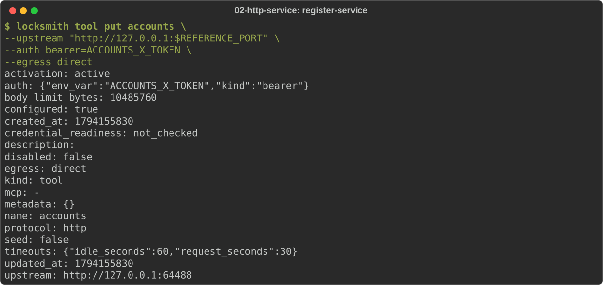
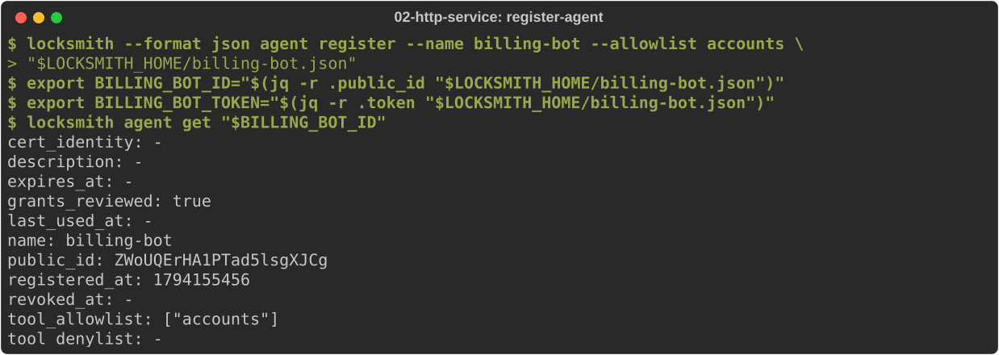
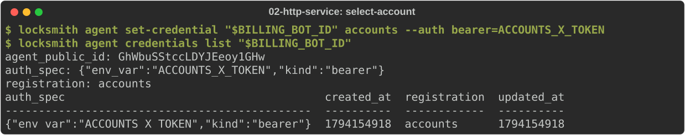
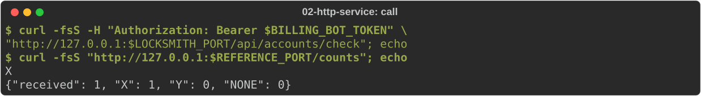
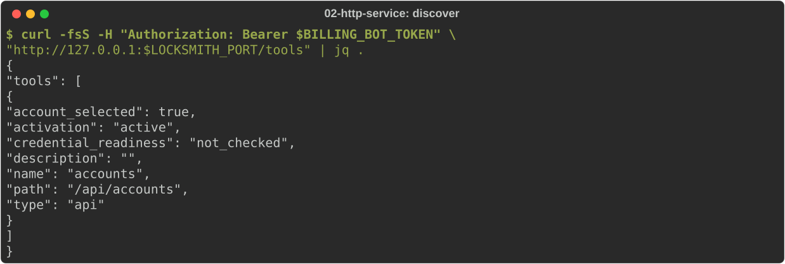
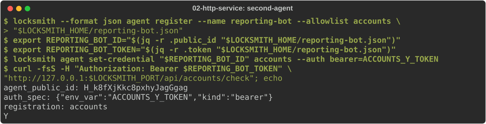
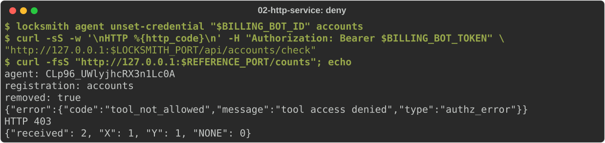
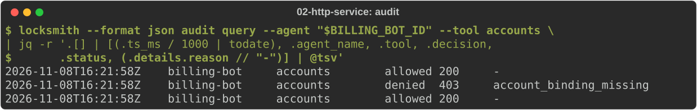

# Connect an HTTP service

You will put an HTTP service behind Locksmith, register two agents, give each
one its own account on that service, and call the service as each agent. You
will also see what happens when an agent loses its account, and how to read
the audit trail.

Start from [journey 1](01-install.md) with the operator credential and the
configuration written. Stop the daemon if it is running: this journey
starts it with the service's credentials in its environment.

Three ideas matter here:

- A **connection** (here, a tool) is an upstream service Locksmith can call:
  its base URL, how it authenticates and how traffic leaves the host.
- An **agent** gets a token and an allowlist of connections it may use.
- An **account selection** says which credential Locksmith presents when
  that agent calls that connection. Without one, the call is refused before
  anything reaches the service.

You also need `curl` and `jq`.

## Run a service to connect

Any HTTP API works. This journey uses the small reference service shipped in
the source tree's `examples/` directory: it accepts two accounts, X and Y,
identified by bearer token, answers `GET /check` with the caller's account,
and counts what it received at `GET /counts`. Set `LOCKSMITH_SRC` to your
checkout, then run it in its own terminal:

<!-- uat:step service bg -->
```sh
python3 "$LOCKSMITH_SRC/examples/http-account-service.py" --port "$REFERENCE_PORT"
```

## Give the daemon the service's credentials

Locksmith reads environment-held credentials from its own process, so they
must be set in the shell that starts the daemon. Each value gets a name, and
everything you configure later refers to the name, never the value:

<!-- uat:step credentials -->
```sh
export ACCOUNTS_X_TOKEN="synthetic-private-account-x"
export ACCOUNTS_Y_TOKEN="synthetic-private-account-y"
```

These two values are the reference service's synthetic accounts. For a real
service, keep credentials in your secret store and use
[stored credentials](../user/concepts/per-agent-credentials.md) or
[1Password references](../user/operator/1password-setup.md) instead.

Start the daemon from this shell and leave it running:

<!-- uat:step start bg -->
```sh
locksmithd --config "$LOCKSMITH_HOME/config.yaml"
```

## Register the service

In your operator shell, register the service as a tool named `accounts`. The
`--auth` value is the catalog default for how the service authenticates;
agents still get no account until you select one for them:

<!-- uat:step register-service -->
```sh
locksmith tool put accounts \
  --upstream "http://127.0.0.1:$REFERENCE_PORT" \
  --auth bearer=ACCOUNTS_X_TOKEN \
  --egress direct
```



`tool put` prints the saved entry. `activation: active` means the daemon is
routing it; `tool get accounts` shows it again later.

`--egress direct` sends traffic straight to the service. Use
`--egress proxied` to route it through your egress proxy.

## Register an agent

Register an agent that may use `accounts`. The response carries the agent's
token once; keep it, because Locksmith stores only its hash:

<!-- uat:step register-agent -->
```sh
locksmith --format json agent register --name billing-bot --allowlist accounts \
  > "$LOCKSMITH_HOME/billing-bot.json"
export BILLING_BOT_ID="$(jq -r .public_id "$LOCKSMITH_HOME/billing-bot.json")"
export BILLING_BOT_TOKEN="$(jq -r .token "$LOCKSMITH_HOME/billing-bot.json")"
locksmith agent get "$BILLING_BOT_ID"
```



Hand the token to the agent through your normal secret channel, then delete
`billing-bot.json`.

## Select the agent's account

The allowlist lets `billing-bot` use `accounts`, but it has no account yet.
Select account X for it:

<!-- uat:step select-account -->
```sh
locksmith agent set-credential "$BILLING_BOT_ID" accounts --auth bearer=ACCOUNTS_X_TOKEN
locksmith agent credentials list "$BILLING_BOT_ID"
```



Reads show the reference (`ACCOUNTS_X_TOKEN`), never the value.

## Call the service as the agent

The agent sends its own token to Locksmith and names the connection in the
path: `/api/<connection>/<path on the service>`. Locksmith removes the
agent's token and presents account X to the service:

<!-- uat:step call -->
```sh
curl -fsS -H "Authorization: Bearer $BILLING_BOT_TOKEN" \
  "http://127.0.0.1:$LOCKSMITH_PORT/api/accounts/check"; echo
curl -fsS "http://127.0.0.1:$REFERENCE_PORT/counts"; echo
```



An agent can list the connections it may use:

<!-- uat:step discover -->
```sh
curl -fsS -H "Authorization: Bearer $BILLING_BOT_TOKEN" \
  "http://127.0.0.1:$LOCKSMITH_PORT/tools" | jq .
```



## A second agent with a different account

Register `reporting-bot` and select account Y for it. Both agents use the
same connection; each gets its own account:

<!-- uat:step second-agent -->
```sh
locksmith --format json agent register --name reporting-bot --allowlist accounts \
  > "$LOCKSMITH_HOME/reporting-bot.json"
export REPORTING_BOT_ID="$(jq -r .public_id "$LOCKSMITH_HOME/reporting-bot.json")"
export REPORTING_BOT_TOKEN="$(jq -r .token "$LOCKSMITH_HOME/reporting-bot.json")"
locksmith agent set-credential "$REPORTING_BOT_ID" accounts --auth bearer=ACCOUNTS_Y_TOKEN
curl -fsS -H "Authorization: Bearer $REPORTING_BOT_TOKEN" \
  "http://127.0.0.1:$LOCKSMITH_PORT/api/accounts/check"; echo
```



## Take an account away, then restore it

Remove billing-bot's account selection. Its next call is refused by
Locksmith with `403 tool_not_allowed`, and nothing reaches the service:

<!-- uat:step deny -->
```sh
locksmith agent unset-credential "$BILLING_BOT_ID" accounts
curl -sS -w '\nHTTP %{http_code}\n' -H "Authorization: Bearer $BILLING_BOT_TOKEN" \
  "http://127.0.0.1:$LOCKSMITH_PORT/api/accounts/check"
curl -fsS "http://127.0.0.1:$REFERENCE_PORT/counts"; echo
```



Select the account again and the agent works at once, with no restart:

<!-- uat:step repair -->
```sh
locksmith agent set-credential "$BILLING_BOT_ID" accounts --auth bearer=ACCOUNTS_X_TOKEN
curl -fsS -H "Authorization: Bearer $BILLING_BOT_TOKEN" \
  "http://127.0.0.1:$LOCKSMITH_PORT/api/accounts/check"; echo
```

Every error response is a JSON envelope with `type`, `code` and `message`.
The common ones on this path:

| Status | Code | Meaning |
|---|---|---|
| 401 | `invalid_credential` | the agent token is missing, wrong or revoked |
| 403 | `tool_not_allowed` | the connection is not on the agent's allowlist, or no account is selected |
| 404 | `tool_not_found` | no active connection by that name |
| 503 | `credential_unresolved` | the selected account's value is missing in the daemon |

## Read the audit trail

Every call, allowed or refused, is recorded. Ask for billing-bot's calls to
`accounts`, newest first. The table view shows every field; this picks the
ones that answer "who called what, and what happened":

<!-- uat:step audit -->
```sh
locksmith --format json audit query --agent "$BILLING_BOT_ID" --tool accounts \
  | jq -r '.[] | [(.ts_ms / 1000 | todate), .agent_name, .tool, .decision,
      .status, (.details.reason // "-")] | @tsv'
```



The audit records the decision and reason. It never records credentials or
request bodies.

Next: keep credentials in Locksmith's own sealed store instead of the
daemon's environment.
