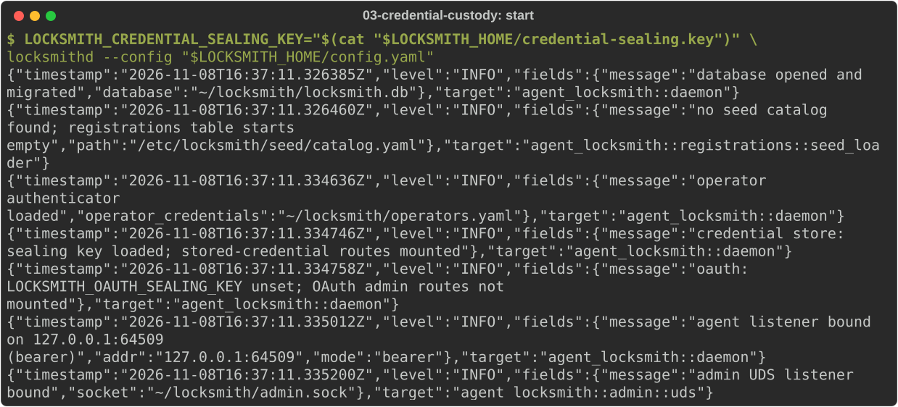
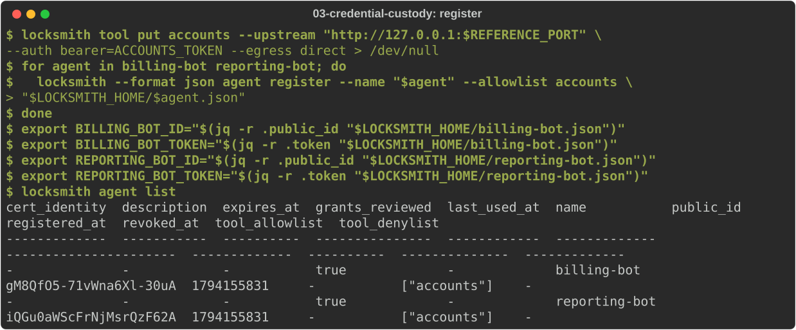
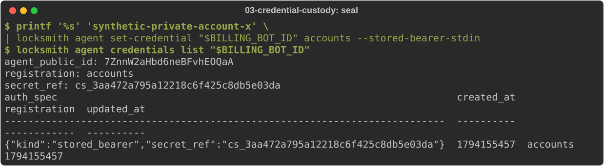
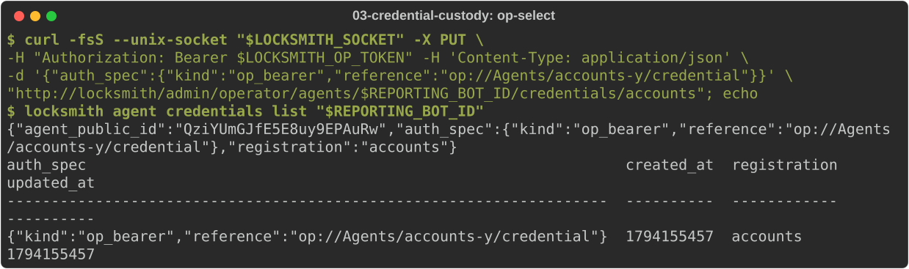
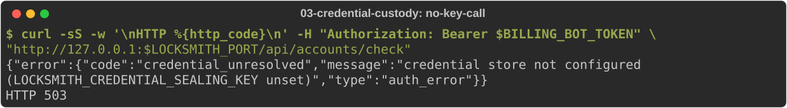

# Keep credentials in Locksmith

In [journey 2](02-http-service.md) the service's credentials sat in the
daemon's environment. This journey keeps them out of the environment
instead, in one of two places:

- **Locksmith's sealed store.** You hand Locksmith a value once. It
  encrypts the value with a sealing key, stores it in its database and
  never shows it again.
- **1Password.** You give Locksmith an `op://` reference. The daemon reads
  it with the 1Password CLI when the selection changes and at startup,
  never per request.

Start from journey 1 with the operator credential and configuration
written, and the daemon stopped.

## Create a sealing key

The sealed store needs a 32-byte key, base64-encoded. Generate one and keep a
backup: without it, sealed values cannot be read, even from a database
backup.

<!-- uat:step sealing-key -->
```sh
umask 077
openssl rand -base64 32 > "$LOCKSMITH_HOME/credential-sealing.key"
```

In production, keep the key in your secret manager or systemd credentials
rather than a file next to the database.

## Start the daemon with the key

Pass the key in `LOCKSMITH_CREDENTIAL_SEALING_KEY`. Run the reference
service from journey 2 as well, if it is not already running:

<!-- uat:step service bg -->
```sh
export REFERENCE_PORT="${REFERENCE_PORT:-9300}"
python3 "$LOCKSMITH_SRC/examples/http-account-service.py" --port "$REFERENCE_PORT"
```

<!-- uat:step start bg -->
```sh
LOCKSMITH_CREDENTIAL_SEALING_KEY="$(cat "$LOCKSMITH_HOME/credential-sealing.key")" \
  locksmithd --config "$LOCKSMITH_HOME/config.yaml"
```



The startup log shows the stored-credential routes are mounted. Without the
key it says they are not.

## Register the service and two agents

The connection's `--auth` names the shape of the credential. Each agent's
actual account comes from its own selection below:

<!-- uat:step register -->
```sh
locksmith tool put accounts --upstream "http://127.0.0.1:$REFERENCE_PORT" \
  --auth bearer=ACCOUNTS_TOKEN --egress direct > /dev/null
for agent in billing-bot reporting-bot; do
  locksmith --format json agent register --name "$agent" --allowlist accounts \
    > "$LOCKSMITH_HOME/$agent.json"
done
export BILLING_BOT_ID="$(jq -r .public_id "$LOCKSMITH_HOME/billing-bot.json")"
export BILLING_BOT_TOKEN="$(jq -r .token "$LOCKSMITH_HOME/billing-bot.json")"
export REPORTING_BOT_ID="$(jq -r .public_id "$LOCKSMITH_HOME/reporting-bot.json")"
export REPORTING_BOT_TOKEN="$(jq -r .token "$LOCKSMITH_HOME/reporting-bot.json")"
locksmith agent list
```



## Seal a credential for an agent

Pipe the value into `set-credential --stored-bearer-stdin`. It never appears
on the command line, in shell history or in process listings. Here the value
is the reference service's synthetic account X; for a real service, pipe it
from your secret manager:

<!-- uat:step seal -->
```sh
printf '%s' 'synthetic-private-account-x' \
  | locksmith agent set-credential "$BILLING_BOT_ID" accounts --stored-bearer-stdin
locksmith agent credentials list "$BILLING_BOT_ID"
```



The agent calls as before:

<!-- uat:step call -->
```sh
curl -fsS -H "Authorization: Bearer $BILLING_BOT_TOKEN" \
  "http://127.0.0.1:$LOCKSMITH_PORT/api/accounts/check"; echo
```

Stop the daemon and start it again with the same key (rerun the start
command above). The sealed value survives in the database:

<!-- uat:step call-after-restart -->
```sh
curl -fsS -H "Authorization: Bearer $BILLING_BOT_TOKEN" \
  "http://127.0.0.1:$LOCKSMITH_PORT/api/accounts/check"; echo
```

To replace the value, run `set-credential --stored-bearer-stdin` again.
Values nothing refers to any more are removed by the credential-store
sweeper after a grace period.

## Select a 1Password reference

Install the [1Password CLI](../user/operator/1password-setup.md) on the
daemon's host and sign it in for the user the daemon runs as. Selecting an
`op://` reference uses the admin API; the `locksmith` CLI has no flag for it
yet. Send it over the admin socket with your operator token:

<!-- uat:step op-select -->
```sh
curl -fsS --unix-socket "$LOCKSMITH_SOCKET" -X PUT \
  -H "Authorization: Bearer $LOCKSMITH_OP_TOKEN" -H 'Content-Type: application/json' \
  -d '{"auth_spec":{"kind":"op_bearer","reference":"op://Agents/accounts-y/credential"}}' \
  "http://locksmith/admin/operator/agents/$REPORTING_BOT_ID/credentials/accounts"; echo
locksmith agent credentials list "$REPORTING_BOT_ID"
```



The daemon read the reference when you saved it. Calls use the cached value:

<!-- uat:step op-call -->
```sh
curl -fsS -H "Authorization: Bearer $REPORTING_BOT_TOKEN" \
  "http://127.0.0.1:$LOCKSMITH_PORT/api/accounts/check"; echo
```

If 1Password cannot resolve the reference, the call fails with
`503 credential_unresolved` and nothing reaches the service.

## When the key is missing

If the daemon starts without its sealing key, it cannot unseal stored
values. Calls that select one fail closed with `503 credential_unresolved`,
rather than reaching the service unauthenticated. To see this, stop the
daemon and start it without the key:

<!-- uat:step start-without-key bg -->
```sh
locksmithd --config "$LOCKSMITH_HOME/config.yaml"
```

<!-- uat:step no-key-call -->
```sh
curl -sS -w '\nHTTP %{http_code}\n' -H "Authorization: Bearer $BILLING_BOT_TOKEN" \
  "http://127.0.0.1:$LOCKSMITH_PORT/api/accounts/check"
```



Start it again with the key and the agent works.

Next: enrol agents with bootstrap tokens and mTLS.
