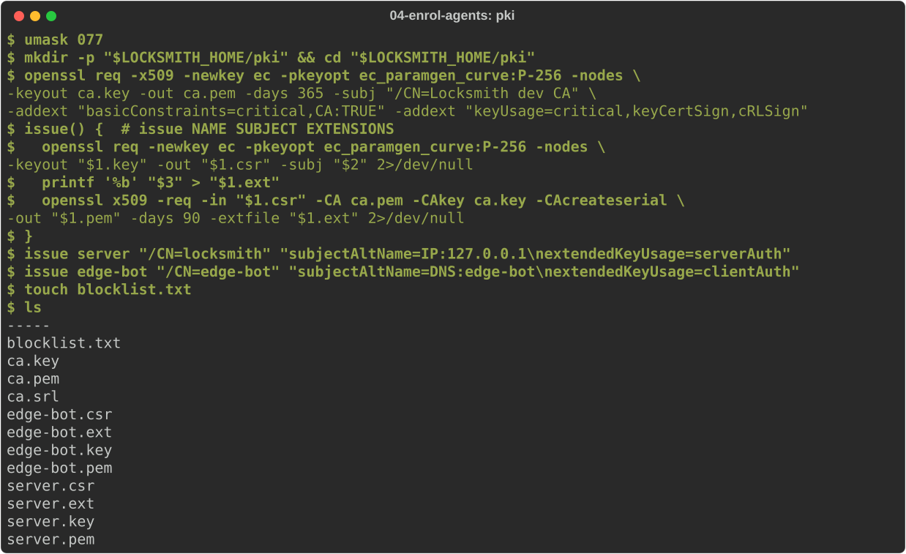
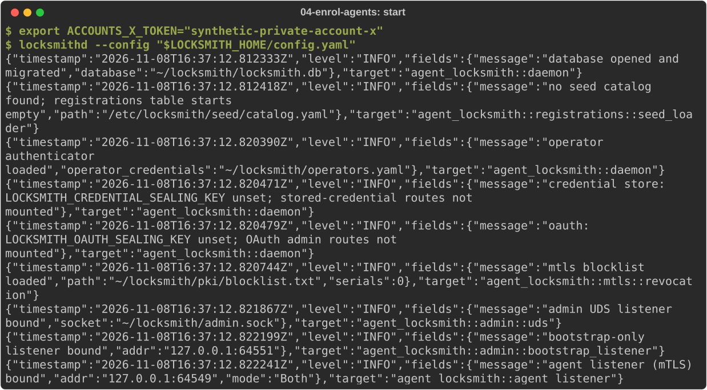
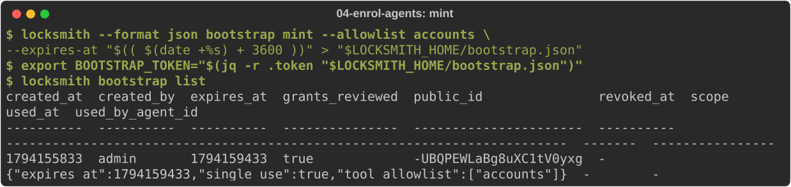
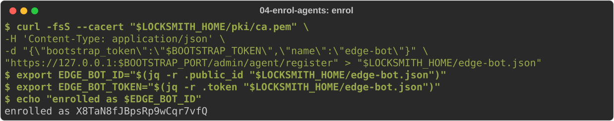
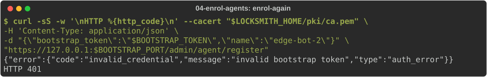
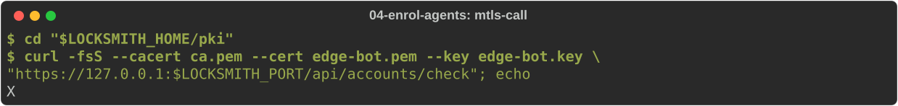
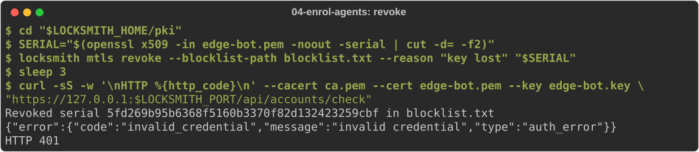

# Enrol agents with bootstrap tokens and certificates

In [journey 2](02-http-service.md) the operator registered each agent and
handed it a token. That does not scale to a fleet. This journey shows two
better ways for an agent to get its identity:

- **Bootstrap tokens.** The operator mints a short-lived token. The agent
  trades it for its own identity on a separate enrolment listener, without
  ever holding an operator credential.
- **Client certificates (mTLS).** The agent proves who it is with a TLS
  client certificate instead of a bearer token. You can revoke the
  certificate within seconds.

Start from [journey 1](01-install.md) with the operator credential written
and the daemon stopped. You need `openssl`, `curl` and `jq`.

## Create a private CA and certificates

Locksmith's TLS listeners need a server certificate, and mTLS agents need
client certificates from a CA that Locksmith trusts. This makes a small
development CA, a server certificate for `127.0.0.1`, and a client
certificate for an agent called `edge-bot`:

<!-- uat:step pki -->
```sh
umask 077
mkdir -p "$LOCKSMITH_HOME/pki" && cd "$LOCKSMITH_HOME/pki"
openssl req -x509 -newkey ec -pkeyopt ec_paramgen_curve:P-256 -nodes \
  -keyout ca.key -out ca.pem -days 365 -subj "/CN=Locksmith dev CA" \
  -addext "basicConstraints=critical,CA:TRUE" -addext "keyUsage=critical,keyCertSign,cRLSign"
issue() {  # issue NAME SUBJECT EXTENSIONS
  openssl req -newkey ec -pkeyopt ec_paramgen_curve:P-256 -nodes \
    -keyout "$1.key" -out "$1.csr" -subj "$2" 2>/dev/null
  # Name the issuing key: strict TLS clients (Python 3.13+) require it.
  printf '%b\nauthorityKeyIdentifier=keyid\nsubjectKeyIdentifier=hash\n' "$3" > "$1.ext"
  openssl x509 -req -in "$1.csr" -CA ca.pem -CAkey ca.key -CAcreateserial \
    -out "$1.pem" -days 90 -extfile "$1.ext" 2>/dev/null
}
issue server "/CN=locksmith" "subjectAltName=IP:127.0.0.1\nextendedKeyUsage=serverAuth"
issue edge-bot "/CN=edge-bot" "subjectAltName=DNS:edge-bot\nextendedKeyUsage=clientAuth"
touch blocklist.txt
ls
```



In production, use your organisation's CA, for example
[smallstep](../../dist/examples/smallstep/README.md).

## Turn on TLS, mTLS and the enrolment listener

Rewrite the configuration. `auth_mode: both` makes the agent port TLS and
accepts either a bearer token or a client certificate. `bootstrap_only`
opens a second TLS port that serves exactly one endpoint, enrolment:

<!-- uat:step config -->
```sh
cat > "$LOCKSMITH_HOME/config.yaml" <<EOF
listen:
  host: "127.0.0.1"
  port: $LOCKSMITH_PORT
  auth_mode: both
  mtls:
    ca_bundle_path: "$LOCKSMITH_HOME/pki/ca.pem"
    server_cert_path: "$LOCKSMITH_HOME/pki/server.pem"
    server_key_path: "$LOCKSMITH_HOME/pki/server.key"
    blocklist_path: "$LOCKSMITH_HOME/pki/blocklist.txt"
    blocklist_reload_interval_seconds: 2
  admin_socket:
    path: "$LOCKSMITH_HOME/admin.sock"
  bootstrap_only:
    enabled: true
    host: "127.0.0.1"
    port: $BOOTSTRAP_PORT
    cert_path: "$LOCKSMITH_HOME/pki/server.pem"
    key_path: "$LOCKSMITH_HOME/pki/server.key"
operator_credentials_path: "$LOCKSMITH_HOME/operators.yaml"
database:
  path: "$LOCKSMITH_HOME/locksmith.db"
tools: []
EOF
```

The blocklist is re-read every 2 seconds here so you can watch a revocation
take effect; the default is 30.

Start the reference service and the daemon as in journey 2:

<!-- uat:step service bg -->
```sh
python3 "$LOCKSMITH_SRC/examples/http-account-service.py" --port "$REFERENCE_PORT"
```

<!-- uat:step start bg -->
```sh
export ACCOUNTS_X_TOKEN="synthetic-private-account-x"
locksmithd --config "$LOCKSMITH_HOME/config.yaml"
```



Register the service as the operator:

<!-- uat:step register-service -->
```sh
locksmith tool put accounts --upstream "http://127.0.0.1:$REFERENCE_PORT" \
  --auth bearer=ACCOUNTS_X_TOKEN --egress direct > /dev/null && echo "accounts registered"
```

## Mint a bootstrap token

The token carries the allowlist the new agent will get. It is single-use
unless you pass `--reusable`, and `--expires-at` (Unix seconds) bounds its
lifetime:

<!-- uat:step mint -->
```sh
locksmith --format json bootstrap mint --allowlist accounts \
  --expires-at "$(( $(date +%s) + 3600 ))" > "$LOCKSMITH_HOME/bootstrap.json"
export BOOTSTRAP_TOKEN="$(jq -r .token "$LOCKSMITH_HOME/bootstrap.json")"
locksmith bootstrap list
```



Give the token to whoever provisions the agent.

## Enrol as the agent

On the agent's machine, trade the token for an identity. This uses the
enrolment port and only needs the CA certificate to trust the server:

<!-- uat:step enrol -->
```sh
curl -fsS --cacert "$LOCKSMITH_HOME/pki/ca.pem" \
  -H 'Content-Type: application/json' \
  -d "{\"bootstrap_token\":\"$BOOTSTRAP_TOKEN\",\"name\":\"edge-bot\"}" \
  "https://127.0.0.1:$BOOTSTRAP_PORT/admin/agent/register" > "$LOCKSMITH_HOME/edge-bot.json"
export EDGE_BOT_ID="$(jq -r .public_id "$LOCKSMITH_HOME/edge-bot.json")"
export EDGE_BOT_TOKEN="$(jq -r .token "$LOCKSMITH_HOME/edge-bot.json")"
echo "enrolled as $EDGE_BOT_ID"
```



The token is spent. Trying it again is refused, and no agent is created:

<!-- uat:step enrol-again -->
```sh
curl -sS -w '\nHTTP %{http_code}\n' --cacert "$LOCKSMITH_HOME/pki/ca.pem" \
  -H 'Content-Type: application/json' \
  -d "{\"bootstrap_token\":\"$BOOTSTRAP_TOKEN\",\"name\":\"edge-bot-2\"}" \
  "https://127.0.0.1:$BOOTSTRAP_PORT/admin/agent/register"
```



The enrolled agent has the token's allowlist but no account yet. Select one
as the operator, then call as the agent. The agent port now speaks TLS:

<!-- uat:step select -->
```sh
locksmith agent set-credential "$EDGE_BOT_ID" accounts --auth bearer=ACCOUNTS_X_TOKEN > /dev/null
curl -fsS --cacert "$LOCKSMITH_HOME/pki/ca.pem" -H "Authorization: Bearer $EDGE_BOT_TOKEN" \
  "https://127.0.0.1:$LOCKSMITH_PORT/api/accounts/check"; echo
```

## Switch the agent to its certificate

Bind the certificate's identity to the agent. Locksmith matches the
certificate's common name first, then its DNS and URI subject alternative
names:

<!-- uat:step bind-cert -->
```sh
locksmith agent set-cert-identity "$EDGE_BOT_ID" edge-bot
```

Now the agent can call with its certificate and no bearer token:

<!-- uat:step mtls-call -->
```sh
cd "$LOCKSMITH_HOME/pki"
curl -fsS --cacert ca.pem --cert edge-bot.pem --key edge-bot.key \
  "https://127.0.0.1:$LOCKSMITH_PORT/api/accounts/check"; echo
```



## Revoke the certificate

If the agent's key is lost, put the certificate's serial on the emergency
blocklist. The daemon picks it up at the next reload, and the next request
with that certificate is refused:

<!-- uat:step revoke -->
```sh
cd "$LOCKSMITH_HOME/pki"
SERIAL="$(openssl x509 -in edge-bot.pem -noout -serial | cut -d= -f2)"
locksmith mtls revoke --blocklist-path blocklist.txt --reason "key lost" "$SERIAL"
sleep 3
curl -sS -w '\nHTTP %{http_code}\n' --cacert ca.pem --cert edge-bot.pem --key edge-bot.key \
  "https://127.0.0.1:$LOCKSMITH_PORT/api/accounts/check"
```



For a fleet, publish a CRL from your CA and set `mtls.crl_url`: the daemon
refreshes it in the background. The blocklist is the local override for
emergencies. See the [revocation runbook](../v2/runbooks/m6-mtls-revocation.md).

Next: connect a service that uses OAuth.
