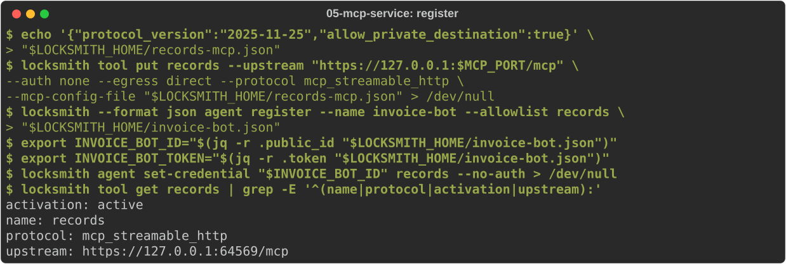
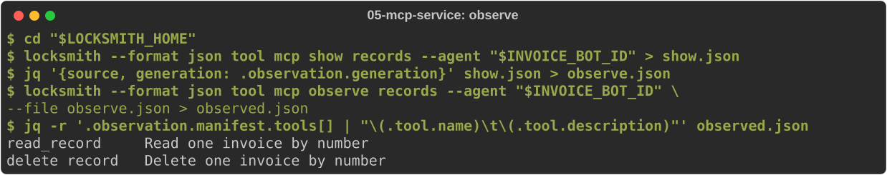
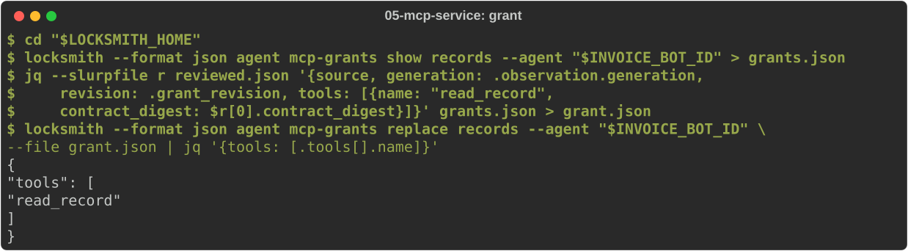
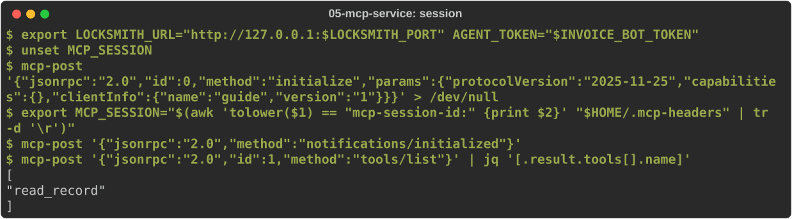
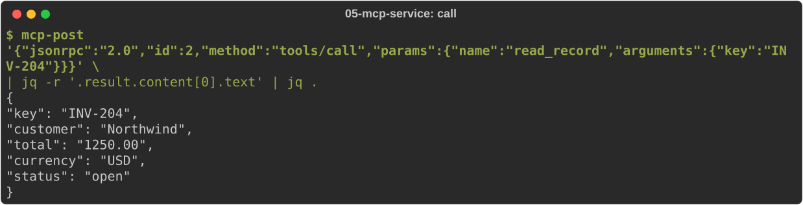
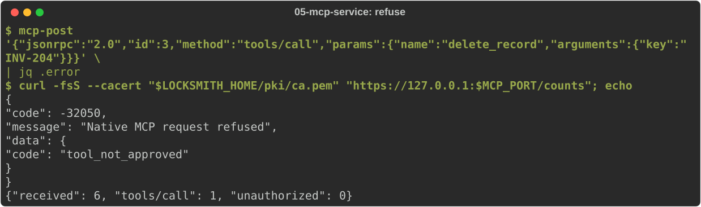

# Connect an MCP service

You will put an MCP server behind Locksmith and let an agent use exactly one
of its tools. Locksmith never passes a tool through just because the server
offers it: the operator observes the server's tools, reviews each contract,
and grants named tools to named agents. The agent then speaks MCP to
Locksmith and sees only what it was granted.

Start from [journey 1](01-install.md) with the operator credential written,
and create the development PKI from [journey 4](04-enrol-agents.md#create-a-private-ca-and-certificates):
the MCP server needs a certificate that Locksmith trusts. You need `curl`
and `jq`.

## Run an MCP server

The source tree ships a small MCP server holding synthetic invoices. It has
two tools: `read_record`, which reads an invoice, and `delete_record`, which
deletes one. Run it in its own terminal with the server certificate:

<!-- uat:step service bg -->
```sh
python3 "$LOCKSMITH_SRC/examples/mcp-records-service.py" --port "$MCP_PORT" \
  --cert "$LOCKSMITH_HOME/pki/server.pem" --key "$LOCKSMITH_HOME/pki/server.key"
```

## Trust the server's CA and start the daemon

Locksmith verifies MCP servers' TLS certificates. Add your CA to the `mcp`
section of the configuration and start the daemon:

<!-- uat:step config -->
```sh
cat > "$LOCKSMITH_HOME/config.yaml" <<EOF
listen:
  host: "127.0.0.1"
  port: $LOCKSMITH_PORT
  auth_mode: bearer
  admin_socket:
    path: "$LOCKSMITH_HOME/admin.sock"
operator_credentials_path: "$LOCKSMITH_HOME/operators.yaml"
database:
  path: "$LOCKSMITH_HOME/locksmith.db"
mcp:
  upstream_ca_bundle: "$LOCKSMITH_HOME/pki/ca.pem"
tools: []
EOF
```

<!-- uat:step start bg -->
```sh
locksmithd --config "$LOCKSMITH_HOME/config.yaml"
```

## Register the server and an agent

An MCP connection is a tool with protocol `mcp_streamable_http` and a small
MCP settings file. `allow_private_destination` is needed only because this
server is on loopback. The agent gets the connection on its allowlist and an
explicit "no account" selection, since this server needs no credential:

<!-- uat:step register -->
```sh
echo '{"protocol_version":"2025-11-25","allow_private_destination":true}' \
  > "$LOCKSMITH_HOME/records-mcp.json"
locksmith tool put records --upstream "https://127.0.0.1:$MCP_PORT/mcp" \
  --auth none --egress direct --protocol mcp_streamable_http \
  --mcp-config-file "$LOCKSMITH_HOME/records-mcp.json" > /dev/null
locksmith --format json agent register --name invoice-bot --allowlist records \
  > "$LOCKSMITH_HOME/invoice-bot.json"
export INVOICE_BOT_ID="$(jq -r .public_id "$LOCKSMITH_HOME/invoice-bot.json")"
export INVOICE_BOT_TOKEN="$(jq -r .token "$LOCKSMITH_HOME/invoice-bot.json")"
locksmith agent set-credential "$INVOICE_BOT_ID" records --no-auth > /dev/null
locksmith tool get records | grep -E '^(name|protocol|activation|upstream):'
```



## Observe what the server offers

Observation connects to the server as that agent's account, lists its tools
and stores what it saw. Each write takes the state it is based on (`source`
and `generation`), so two operators cannot overwrite each other unknowingly:

<!-- uat:step observe -->
```sh
cd "$LOCKSMITH_HOME"
locksmith --format json tool mcp show records --agent "$INVOICE_BOT_ID" > show.json
jq '{source, generation: .observation.generation}' show.json > observe.json
locksmith --format json tool mcp observe records --agent "$INVOICE_BOT_ID" \
  --file observe.json > observed.json
jq -r '.observation.manifest.tools[] | "\(.tool.name)\t\(.tool.description)"' observed.json
```



## Review and grant one tool

Review records your judgment of one exact tool contract and its effect
(`read` or `write`). Here you review `read_record` only:

<!-- uat:step review -->
```sh
cd "$LOCKSMITH_HOME"
jq '{source, generation: .observation.generation, name: "read_record", effect: "read",
     observed_digest: (.observation.manifest.tools[] | select(.tool.name == "read_record")
     | .observed_digest)}' observed.json > review.json
locksmith --format json tool mcp review records --agent "$INVOICE_BOT_ID" \
  --file review.json > reviewed.json
jq '{name, effect, contract_digest}' reviewed.json
```

Reviewing grants nothing by itself. Replace the agent's grants for this
connection with exactly the reviewed tool:

<!-- uat:step grant -->
```sh
cd "$LOCKSMITH_HOME"
locksmith --format json agent mcp-grants show records --agent "$INVOICE_BOT_ID" > grants.json
jq --slurpfile r reviewed.json '{source, generation: .observation.generation,
    revision: .grant_revision, tools: [{name: "read_record",
    contract_digest: $r[0].contract_digest}]}' grants.json > grant.json
locksmith --format json agent mcp-grants replace records --agent "$INVOICE_BOT_ID" \
  --file grant.json | jq '{tools: [.tools[].name]}'
```



## Use the tool as the agent

The agent speaks ordinary streamable-HTTP MCP to `/mcp/<connection>` with its
own token. Any MCP client library works; this small helper uses curl so you
can see each message. Save it on the agent's machine:

<!-- uat:step helper -->
```sh
mkdir -p "$HOME/bin"
cat > "$HOME/bin/mcp-post" <<'EOF'
#!/usr/bin/env bash
# mcp-post JSON: POST one MCP message to Locksmith as the agent; print the reply.
set -o pipefail
curl -fsS "$LOCKSMITH_URL/mcp/records" \
  -H "Authorization: Bearer $AGENT_TOKEN" -H 'Content-Type: application/json' \
  -H 'Accept: application/json, text/event-stream' \
  ${MCP_SESSION:+-H "Mcp-Session-Id: $MCP_SESSION" -H 'MCP-Protocol-Version: 2025-11-25'} \
  -D "$HOME/.mcp-headers" -d "$1" | sed 's/^data: //' | { grep '^{' || true; }
EOF
chmod +x "$HOME/bin/mcp-post"
export PATH="$HOME/bin:$PATH"
```

Open a session, then list the tools the agent may use:

<!-- uat:step session -->
```sh
export LOCKSMITH_URL="http://127.0.0.1:$LOCKSMITH_PORT" AGENT_TOKEN="$INVOICE_BOT_TOKEN"
unset MCP_SESSION
mcp-post '{"jsonrpc":"2.0","id":0,"method":"initialize","params":{"protocolVersion":"2025-11-25","capabilities":{},"clientInfo":{"name":"guide","version":"1"}}}' > /dev/null
export MCP_SESSION="$(awk 'tolower($1) == "mcp-session-id:" {print $2}' "$HOME/.mcp-headers" | tr -d '\r')"
mcp-post '{"jsonrpc":"2.0","method":"notifications/initialized"}'
mcp-post '{"jsonrpc":"2.0","id":1,"method":"tools/list"}' | jq '[.result.tools[].name]'
```



Call it:

<!-- uat:step call -->
```sh
mcp-post '{"jsonrpc":"2.0","id":2,"method":"tools/call","params":{"name":"read_record","arguments":{"key":"INV-204"}}}' \
  | jq -r '.result.content[0].text' | jq .
```



A tool the agent was not granted is refused by Locksmith, and the server
never sees the call:

<!-- uat:step refuse -->
```sh
mcp-post '{"jsonrpc":"2.0","id":3,"method":"tools/call","params":{"name":"delete_record","arguments":{"key":"INV-204"}}}' \
  | jq .error
curl -fsS --cacert "$LOCKSMITH_HOME/pki/ca.pem" "https://127.0.0.1:$MCP_PORT/counts"; echo
```



The server's counts show one tool call, the read.

## When the server changes

If the server changes a granted tool's contract, the grant no longer matches
and calls are refused until you observe, review and grant again. A new grant
takes effect in a new session. See [native tool review](../user/operator/native-tool-review.md)
and [the agent interface](../user/agent-integration/native-mcp.md) for the
full rules, and [compact MCP](../user/agent-integration/compact-mcp.md) for a
search-describe-invoke facade over the same grants.
