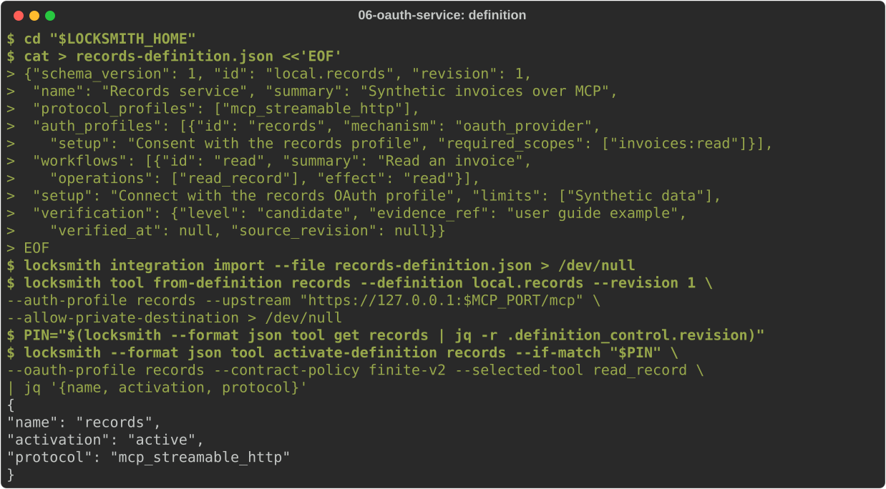
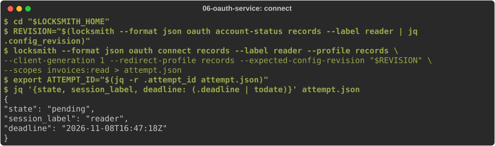
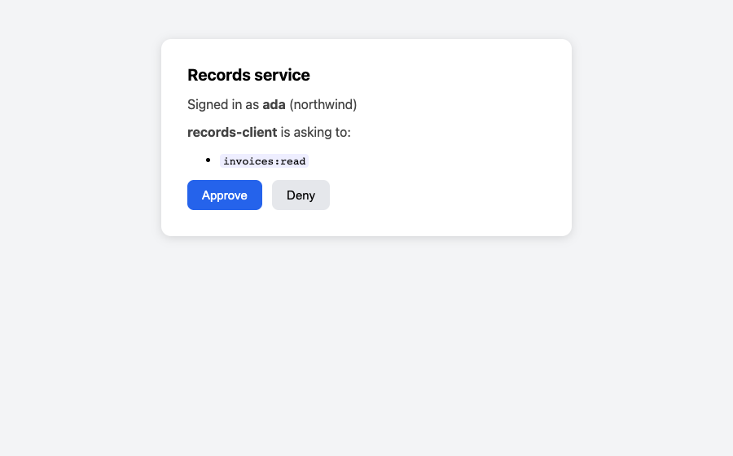
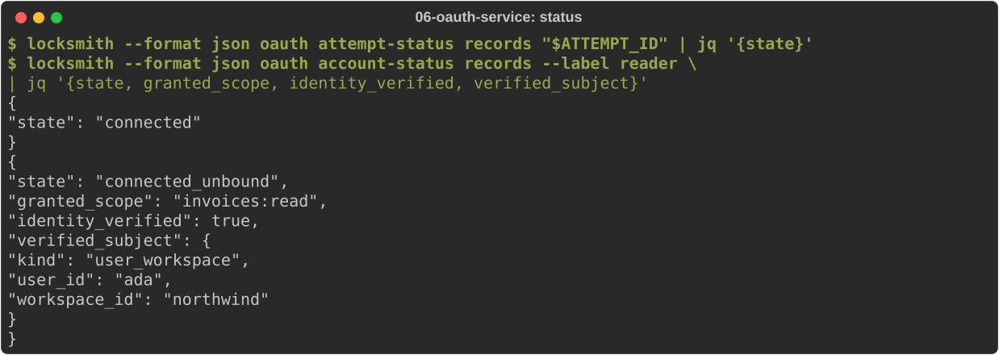
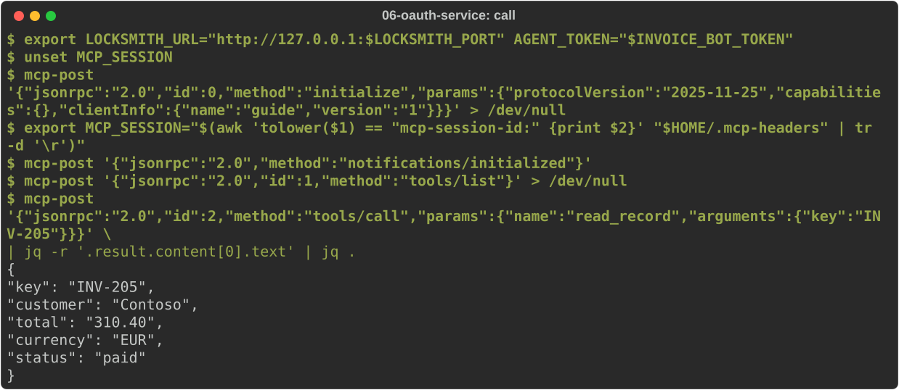

# Connect an OAuth service

Some services only issue credentials through OAuth: a person signs in at the
provider and approves access. Locksmith runs that flow for you, keeps the
resulting tokens sealed, checks that they belong to the account you expected,
and lets you choose which agents act as that account. Agents never see the
tokens.

This journey connects the records service from [journey 5](05-mcp-service.md)
again, this time protected by OAuth. Start from [journey 1](01-install.md)
with the operator credential written, and the development PKI from
[journey 4](04-enrol-agents.md#create-a-private-ca-and-certificates). You
need a browser, `curl`, `jq` and `openssl`.

## The pieces

- A **profile** in the daemon's configuration declares the provider's
  contract: its endpoints, client, scopes, how its token response looks and
  which identity the account must have. Locksmith refuses anything that does
  not match.
- A **callback listener** receives the browser's redirect after approval.
- An **account** is the stored result of one approval, under a label you
  choose. It does nothing until you select it for an agent.

## Run the provider

Register Locksmith as a client with the provider. Real providers give you a
client ID and secret in their developer console; the records service takes
its secret from an environment variable, so make one up and keep it in a
private file:

<!-- uat:step client-secret -->
```sh
umask 077
openssl rand -hex 24 > "$LOCKSMITH_HOME/records-client-secret.txt"
```

Run the records service with `--oauth`. It is now also the OAuth provider:
it shows a consent page, issues tokens and answers "who is this token for?":

<!-- uat:step service bg -->
```sh
export MCP_PORT="${MCP_PORT:-9400}"
RECORDS_CLIENT_SECRET="$(cat "$LOCKSMITH_HOME/records-client-secret.txt")" \
  python3 "$LOCKSMITH_SRC/examples/mcp-records-service.py" --port "$MCP_PORT" --oauth \
  --cert "$LOCKSMITH_HOME/pki/server.pem" --key "$LOCKSMITH_HOME/pki/server.key"
```

## Declare the profile and start the daemon

OAuth custody needs two sealing keys: one for OAuth tokens and one for the
client secret Locksmith stores. Create them as in
[journey 3](03-credential-custody.md):

<!-- uat:step keys -->
```sh
umask 077
openssl rand -base64 32 > "$LOCKSMITH_HOME/oauth-sealing.key"
openssl rand -base64 32 > "$LOCKSMITH_HOME/credential-sealing.key"
```

Write the configuration. The `oauth_consent` section holds the callback
listener and the declared profile:

<!-- uat:step config -->
```sh
export CALLBACK_PORT="${CALLBACK_PORT:-9444}"
PROVIDER="https://127.0.0.1:$MCP_PORT"
cat > "$LOCKSMITH_HOME/config.yaml" <<EOF
listen:
  host: "127.0.0.1"
  port: $LOCKSMITH_PORT
  auth_mode: bearer
  admin_socket:
    path: "$LOCKSMITH_HOME/admin.sock"
operator_credentials_path: "$LOCKSMITH_HOME/operators.yaml"
database:
  path: "$LOCKSMITH_HOME/locksmith.db"
mcp:
  upstream_ca_bundle: "$LOCKSMITH_HOME/pki/ca.pem"
oauth_consent:
  callback:
    address: "127.0.0.1:$CALLBACK_PORT"
    cert_path: "$LOCKSMITH_HOME/pki/server.pem"
    key_path: "$LOCKSMITH_HOME/pki/server.key"
  profiles:
    - id: records
      kind: custom-oauth-v1
      client_id: records-client
      client_generation: 1
      issuer: "$PROVIDER"
      authorization_endpoint: "$PROVIDER/authorize"
      token_endpoint: "$PROVIDER/token"
      resource: "$PROVIDER/resource"
      redirect_profile_id: records
      redirect_uri: "https://127.0.0.1:$CALLBACK_PORT/oauth/callback/custom/records"
      ca_path: "$LOCKSMITH_HOME/pki/ca.pem"
      contract:
        version: 1
        grant: authorization_code_s256
        registration: pre_registered
        client_auth: client_secret_post
        approved_origins: ["$PROVIDER"]
        mcp_endpoint: "$PROVIDER/mcp"
        callback: distinct_redirect
        scope:
          required: ["invoices:read"]
          request_separator: space
          response_separator: space
        token_response: oauth2-bearer-v1
        identity:
          endpoint: "$PROVIDER/whoami"
          method: get
          response: workspace-user-v1
        subject:
          kind: user_workspace
          workspace_id: northwind
          user_id: ada
tools: []
EOF
```

The `subject` is the account you expect. After approval, Locksmith asks the
provider's identity endpoint who the token belongs to and refuses the
account if the answer differs. Start the daemon with both keys:

<!-- uat:step start bg -->
```sh
LOCKSMITH_OAUTH_SEALING_KEY="$(cat "$LOCKSMITH_HOME/oauth-sealing.key")" \
LOCKSMITH_CREDENTIAL_SEALING_KEY="$(cat "$LOCKSMITH_HOME/credential-sealing.key")" \
  locksmithd --config "$LOCKSMITH_HOME/config.yaml"
```

## Define the connection

An integration definition describes the service once: its protocol, the
OAuth scopes it needs and what its tools do. Import it, create a connection
from it, and activate the connection with the profile. Activation contacts
nobody:

<!-- uat:step definition -->
```sh
cd "$LOCKSMITH_HOME"
cat > records-definition.json <<'EOF'
{"schema_version": 1, "id": "local.records", "revision": 1,
 "name": "Records service", "summary": "Synthetic invoices over MCP",
 "protocol_profiles": ["mcp_streamable_http"],
 "auth_profiles": [{"id": "records", "mechanism": "oauth_provider",
   "setup": "Consent with the records profile", "required_scopes": ["invoices:read"]}],
 "workflows": [{"id": "read", "summary": "Read an invoice",
   "operations": ["read_record"], "effect": "read"}],
 "setup": "Connect with the records OAuth profile", "limits": ["Synthetic data"],
 "verification": {"level": "candidate", "evidence_ref": "user guide example",
   "verified_at": null, "source_revision": null}}
EOF
locksmith integration import --file records-definition.json > /dev/null
locksmith tool from-definition records --definition local.records --revision 1 \
  --auth-profile records --upstream "https://127.0.0.1:$MCP_PORT/mcp" \
  --allow-private-destination > /dev/null
PIN="$(locksmith --format json tool get records | jq -r .definition_control.revision)"
locksmith --format json tool activate-definition records --if-match "$PIN" \
  --oauth-profile records --contract-policy finite-v2 --selected-tool read_record \
  | jq '{name, activation, protocol}'
```



## Store the client secret

Give Locksmith the client secret through stdin. It is sealed under the
credential key and never shown again:

<!-- uat:step client -->
```sh
locksmith oauth client set records --profile records --client-generation 1 \
  --secret-stdin < "$LOCKSMITH_HOME/records-client-secret.txt" > /dev/null
locksmith --format json oauth client status records --profile records --client-generation 1 \
  | jq '{state}'
```

## Approve access in the browser

Start a consent attempt for an account labelled `reader`. Each attempt is
tied to the configuration it was started under, so pass the current
`config_revision`:

<!-- uat:step connect -->
```sh
cd "$LOCKSMITH_HOME"
REVISION="$(locksmith --format json oauth account-status records --label reader | jq .config_revision)"
locksmith --format json oauth connect records --label reader --profile records \
  --client-generation 1 --redirect-profile records --expected-config-revision "$REVISION" \
  --scopes invoices:read > attempt.json
export ATTEMPT_ID="$(jq -r .attempt_id attempt.json)"
jq '{state, session_label, deadline: (.deadline | todate)}' attempt.json
```



The response's `authorization_url` contains a one-time secret, so it is
written to the file rather than printed. Open it in the browser of the
person who owns the account:

```sh
open "$(jq -r .authorization_url "$LOCKSMITH_HOME/attempt.json")"   # macOS; use xdg-open on Linux
```

The provider shows its consent page. Your development CA is not in the
browser's trust store, so it warns first; real providers have public
certificates.



Approve. The provider sends the browser back to Locksmith's callback
listener, which exchanges the code, verifies the identity and seals the
tokens:


The browser page is only a hint. Check the outcome with the CLI:

<!-- uat:step status -->
```sh
locksmith --format json oauth attempt-status records "$ATTEMPT_ID" | jq '{state}'
locksmith --format json oauth account-status records --label reader \
  | jq '{state, granted_scope, identity_verified, verified_subject}'
```



`connected_unbound` means the account is connected and its identity verified.
It grants nothing until you select it for an agent.

## Let an agent act as the account

Register an agent, then select the account for it. Selection names the
account revision you are looking at, so a reconnect in between is not
silently picked up:

<!-- uat:step select -->
```sh
cd "$LOCKSMITH_HOME"
locksmith --format json agent register --name invoice-bot --allowlist records > invoice-bot.json
export INVOICE_BOT_ID="$(jq -r .public_id invoice-bot.json)"
export INVOICE_BOT_TOKEN="$(jq -r .token invoice-bot.json)"
ACCOUNT="$(locksmith --format json oauth account-status records --label reader | jq -r .revision)"
locksmith --format json agent select-oauth "$INVOICE_BOT_ID" records --label reader \
  --if-match "$ACCOUNT" | jq '{session_label: .selection.session_label, callable}'
```

`callable: false` because no tool is granted yet. Observe, review and grant
`read_record` exactly as in [journey 5](05-mcp-service.md#observe-what-the-server-offers);
the observation now runs with the consented account. Contracts under the
`finite-v2` policy are reviewed with that policy:

<!-- uat:step grant -->
```sh
cd "$LOCKSMITH_HOME"
locksmith --format json tool mcp show records --agent "$INVOICE_BOT_ID" \
  | jq '{source, generation: .observation.generation}' > observe.json
locksmith --format json tool mcp observe records --agent "$INVOICE_BOT_ID" --file observe.json > observed.json
jq '{source, generation: .observation.generation, name: "read_record", effect: "read",
     contract_policy: "finite-v2", observed_digest: (.observation.manifest.tools[]
     | select(.tool.name == "read_record") | .observed_digest)}' observed.json > review.json
locksmith --format json tool mcp review records --agent "$INVOICE_BOT_ID" --file review.json > reviewed.json
jq --slurpfile r reviewed.json '{source, generation: .observation.generation,
    revision: .grant_revision, tools: [{name: "read_record", contract_digest: $r[0].contract_digest}]}' \
  observed.json > grant.json
locksmith --format json agent mcp-grants replace records --agent "$INVOICE_BOT_ID" --file grant.json \
  | jq '{tools: [.tools[].name]}'
```

Now the agent calls the tool with the `mcp-post` helper from
[journey 5](05-mcp-service.md#use-the-tool-as-the-agent). The service only
answers requests that carry an access token it issued, so this works only
because Locksmith attached the account's token:

<!-- uat:step call -->
```sh
export LOCKSMITH_URL="http://127.0.0.1:$LOCKSMITH_PORT" AGENT_TOKEN="$INVOICE_BOT_TOKEN"
unset MCP_SESSION
mcp-post '{"jsonrpc":"2.0","id":0,"method":"initialize","params":{"protocolVersion":"2025-11-25","capabilities":{},"clientInfo":{"name":"guide","version":"1"}}}' > /dev/null
export MCP_SESSION="$(awk 'tolower($1) == "mcp-session-id:" {print $2}' "$HOME/.mcp-headers" | tr -d '\r')"
mcp-post '{"jsonrpc":"2.0","method":"notifications/initialized"}'
mcp-post '{"jsonrpc":"2.0","id":1,"method":"tools/list"}' > /dev/null
mcp-post '{"jsonrpc":"2.0","id":2,"method":"tools/call","params":{"name":"read_record","arguments":{"key":"INV-205"}}}' \
  | jq -r '.result.content[0].text' | jq .
```



## Renew the tokens

Locksmith refreshes on demand when a token is about to expire. You can also
renew deliberately, naming the account revision:

<!-- uat:step refresh -->
```sh
ACCOUNT="$(locksmith --format json oauth account-status records --label reader | jq -r .revision)"
locksmith --format json oauth refresh records --label reader --if-match "$ACCOUNT" > /dev/null
locksmith --format json oauth account-status records --label reader | jq '{state, identity_verified}'
```

A renewal verifies the identity again and changes the token version, which
retires existing grants: observe, review and grant again before the agent's
next session. To end access, `oauth disconnect records --label reader
--if-match REVISION` removes the account. See
[native OAuth accounts](../user/operator/native-oauth.md) and
[declared OAuth contracts](../user/operator/custom-oauth.md).
