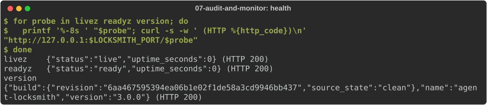
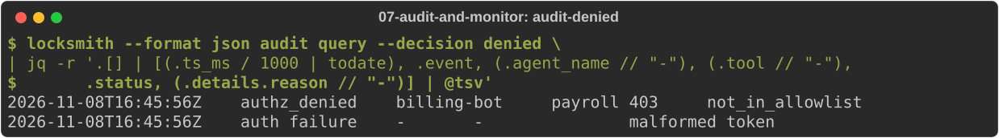
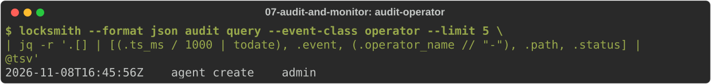
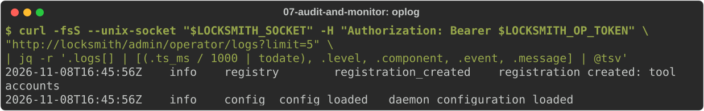
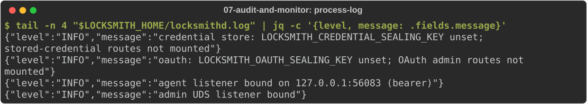

# Audit and monitor

Locksmith keeps three records, each for a different reader:

| Record | What it holds | Where |
|---|---|---|
| **Audit** | one row per agent request and per admin change: who, what, the decision and why | the database, optionally mirrored to a JSONL file |
| **Operational log** | secret-free events about the daemon's own state: agents, the catalog, OAuth, configuration | the database, read through the admin API |
| **Process log** | the daemon's JSON log lines | stdout, or the file in `logging.file` |

None of them ever holds a credential or a request body. This journey sets
all three up, makes some traffic, and reads each one. Start from
[journey 1](01-install.md) with the operator credential written and the
daemon stopped.

## Configure the records

Add `logging`, `audit` and `operational_log` sections to the configuration:

<!-- uat:step config -->
```sh
cat > "$LOCKSMITH_HOME/config.yaml" <<EOF
listen:
  host: "127.0.0.1"
  port: $LOCKSMITH_PORT
  auth_mode: bearer
  admin_socket:
    path: "$LOCKSMITH_HOME/admin.sock"
operator_credentials_path: "$LOCKSMITH_HOME/operators.yaml"
database:
  path: "$LOCKSMITH_HOME/locksmith.db"
logging:
  level: info
  file: "$LOCKSMITH_HOME/locksmithd.log"
audit:
  retention_days: 30
  jsonl_path: "$LOCKSMITH_HOME/audit.jsonl"
operational_log:
  retention_days: 30
tools: []
EOF
```

- `logging.file` appends the process log to a file (mode 0640) instead of
  stdout. The directory must exist; the daemon refuses to start otherwise.
  The file is not reopened, so rotate it with `copytruncate`.
- `audit.jsonl_path` mirrors every audit row to JSONL for your log
  pipeline. The path is a base name: the daemon writes one file per UTC day,
  `audit.jsonl.YYYY-MM-DD`, starts a numbered overflow (`.1`, `.2`, …) past
  `jsonl_max_bytes` (default 100 MiB) and keeps `jsonl_keep_files` files
  (default 14). Point your shipper at `audit.jsonl.*`.
- `retention_days` bounds how long rows stay in the database.

Run the reference service and the daemon as in [journey 2](02-http-service.md),
with account X in the daemon's environment:

<!-- uat:step service bg -->
```sh
python3 "$LOCKSMITH_SRC/examples/http-account-service.py" --port "$REFERENCE_PORT"
```

<!-- uat:step start bg -->
```sh
export ACCOUNTS_X_TOKEN="synthetic-private-account-x"
locksmithd --config "$LOCKSMITH_HOME/config.yaml"
```

Register `accounts` and `billing-bot` with account X, as in journey 2.

## Make some traffic

One allowed call, one with a bad token and one to a connection the agent
may not use:

<!-- uat:step traffic -->
```sh
api="http://127.0.0.1:$LOCKSMITH_PORT/api"
curl -s -o /dev/null -w '%{http_code} allowed\n' -H "Authorization: Bearer $BILLING_BOT_TOKEN" "$api/accounts/check"
curl -s -o /dev/null -w '%{http_code} bad token\n' -H "Authorization: Bearer wrong-token" "$api/accounts/check"
curl -s -o /dev/null -w '%{http_code} not allowed\n' -H "Authorization: Bearer $BILLING_BOT_TOKEN" "$api/payroll/run"
```

## Watch health

Point your monitoring at these unauthenticated endpoints on the agent port:

<!-- uat:step health -->
```sh
for probe in livez readyz version; do
  printf '%-8s ' "$probe"; curl -s -w ' (HTTP %{http_code})\n' "http://127.0.0.1:$LOCKSMITH_PORT/$probe"
done
```



Alert when `/readyz` is not 200: a startup dependency is missing. A ready
daemon can still refuse an individual agent whose selected account is
unavailable, with `503 credential_unresolved`; those refusals are in the
audit.

## Read the audit

Ask for refusals. Each row says which agent, which connection, the HTTP
status and the reason:

<!-- uat:step audit-denied -->
```sh
locksmith --format json audit query --decision denied \
  | jq -r '.[] | [(.ts_ms / 1000 | todate), .event, (.agent_name // "-"), (.tool // "-"),
      .status, (.details.reason // "-")] | @tsv'
```



Filter further with `--agent`, `--tool`, `--event-class` (`proxy`,
`operator` or `security`), `--since-ms` and `--until-ms` (Unix
milliseconds), `--limit` and `--offset`. Admin changes are audited too:

<!-- uat:step audit-operator -->
```sh
locksmith --format json audit query --event-class operator --limit 5 \
  | jq -r '.[] | [(.ts_ms / 1000 | todate), .event, (.operator_name // "-"), .path, .status] | @tsv'
```



The JSONL mirror carries the same rows, one JSON object per line:

<!-- uat:step jsonl -->
```sh
ls "$LOCKSMITH_HOME" | grep '^audit.jsonl'
tail -q -n 3 "$LOCKSMITH_HOME"/audit.jsonl.* | jq -c '{event, decision, tool, status}'
```

## Read the operational log

The operational log answers "what happened to the daemon's state?". It has
no CLI command yet; read it through the admin API, filtering by `level`
(`info`, `warn`, `error`) and `component` (`oauth`, `registry`, `agent`,
`proxy`, `config`):

<!-- uat:step oplog -->
```sh
curl -fsS --unix-socket "$LOCKSMITH_SOCKET" -H "Authorization: Bearer $LOCKSMITH_OP_TOKEN" \
  "http://locksmith/admin/operator/logs?limit=5" \
  | jq -r '.logs[] | [(.ts_ms / 1000 | todate), .level, .component, .event, .message] | @tsv'
```



## Read the process log

<!-- uat:step process-log -->
```sh
tail -n 4 "$LOCKSMITH_HOME/locksmithd.log" | jq -c '{level, message: .fields.message}'
```



## Snapshot the agents

For an access review, export every agent with its allowlist and status:

<!-- uat:step export -->
```sh
locksmith --format json export agents \
  | jq -r '.[] | [.name, (.tool_allowlist | join(",")), (.revoked_at // "active")] | @tsv'
```
