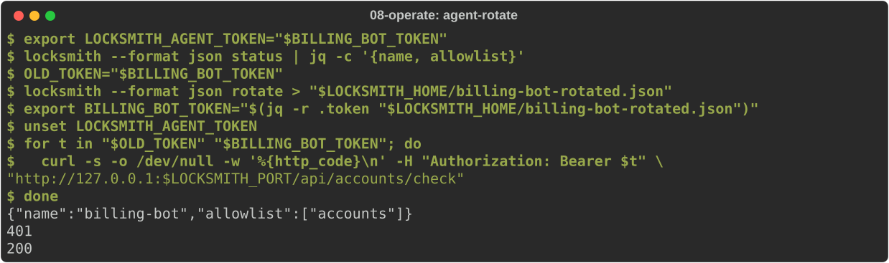
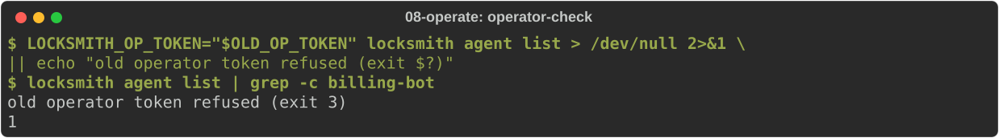
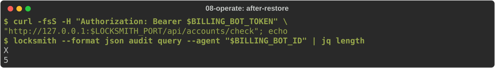
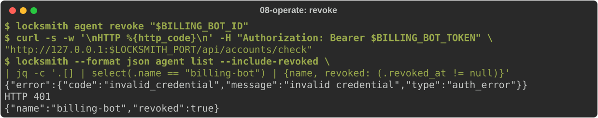

# Day-two operations

You will rotate an agent's token and the operator's token, back up and
restore an instance, and revoke an agent. Start from
[journey 2](02-http-service.md): the daemon running with `accounts` and
`billing-bot`. You also need `sqlite3`.

## An agent rotates its own token

An agent can check its own status and replace its token without the
operator, over the admin socket or admin HTTPS. It authenticates with its
current token from `LOCKSMITH_AGENT_TOKEN`:

<!-- uat:step agent-rotate -->
```sh
export LOCKSMITH_AGENT_TOKEN="$BILLING_BOT_TOKEN"
locksmith --format json status | jq -c '{name, allowlist}'
OLD_TOKEN="$BILLING_BOT_TOKEN"
locksmith --format json rotate > "$LOCKSMITH_HOME/billing-bot-rotated.json"
export BILLING_BOT_TOKEN="$(jq -r .token "$LOCKSMITH_HOME/billing-bot-rotated.json")"
unset LOCKSMITH_AGENT_TOKEN
for t in "$OLD_TOKEN" "$BILLING_BOT_TOKEN"; do
  curl -s -o /dev/null -w '%{http_code}\n' -H "Authorization: Bearer $t" \
    "http://127.0.0.1:$LOCKSMITH_PORT/api/accounts/check"
done
```



The old token fails with 401 and the new one works. The agent's identity,
allowlist and account selections are unchanged.

## Rotate the operator token

The operators file is read only at startup. Mint a new credential, replace
the file, and restart the daemon:

<!-- uat:step rotate-operator -->
```sh
umask 077
cd "$LOCKSMITH_HOME"
export OLD_OP_TOKEN="$LOCKSMITH_OP_TOKEN"
locksmith bootstrap-operator --name admin > operators.yaml.new 2> operator-token.txt
mv operators.yaml.new operators.yaml
eval "$(grep 'export LOCKSMITH_OP_TOKEN=' operator-token.txt)"
rm operator-token.txt
echo "new operator token loaded"
```

Restart the daemon (Control-C, then the start command from journey 2).
Then the old token is refused and the new one works:

<!-- uat:step operator-check -->
```sh
LOCKSMITH_OP_TOKEN="$OLD_OP_TOKEN" locksmith agent list > /dev/null 2>&1 \
  || echo "old operator token refused (exit $?)"
locksmith agent list | grep -c billing-bot
```



To rotate without a gap, put both operators in the file, restart, move your
tooling to the new token, then remove the old entry and restart again.

## Back up

Back up while the daemon runs. SQLite's `.backup` takes a consistent copy,
including what is still in the write-ahead log; copying `locksmith.db`
alone can miss committed changes:

<!-- uat:step backup -->
```sh
mkdir -p "$HOME/locksmith-backup" && chmod 700 "$HOME/locksmith-backup"
sqlite3 "$LOCKSMITH_HOME/locksmith.db" ".backup '$HOME/locksmith-backup/locksmith.db'"
cp "$LOCKSMITH_HOME/config.yaml" "$LOCKSMITH_HOME/operators.yaml" "$HOME/locksmith-backup/"
ls "$HOME/locksmith-backup"
```

The database holds sealed credentials and OAuth tokens. They are useless
without the sealing keys, so back the keys up separately, under a different
control, and never next to the database copy.

## Restore

Suppose the database is lost. Stop the daemon, put the backup in place, and
start it again:

<!-- uat:step restore -->
```sh
cd "$LOCKSMITH_HOME"
mkdir -p lost && mv locksmith.db* lost/
cp "$HOME/locksmith-backup/locksmith.db" locksmith.db
ls
```

Start the daemon, then check that the agent and its history came back:

<!-- uat:step after-restore -->
```sh
curl -fsS -H "Authorization: Bearer $BILLING_BOT_TOKEN" \
  "http://127.0.0.1:$LOCKSMITH_PORT/api/accounts/check"; echo
locksmith --format json audit query --agent "$BILLING_BOT_ID" | jq length
```



Anything changed after the backup was taken is not in the restored copy.
For sealed state, see [sealed-state recovery](../user/operator/sealed-state-recovery.md).

## Revoke an agent

When an agent is retired or compromised, revoke it. Its token stops working
on the next request; requests already in flight may finish:

<!-- uat:step revoke -->
```sh
locksmith agent revoke "$BILLING_BOT_ID"
curl -s -w '\nHTTP %{http_code}\n' -H "Authorization: Bearer $BILLING_BOT_TOKEN" \
  "http://127.0.0.1:$LOCKSMITH_PORT/api/accounts/check"
locksmith --format json agent list --include-revoked \
  | jq -c '.[] | select(.name == "billing-bot") | {name, revoked: (.revoked_at != null)}'
```



Revocation keeps the agent's record and audit history. The name stays taken.
`agent list` hides revoked agents, and `agent get` by public ID does not
find them; add `--include-revoked` to `agent list` to see them.
