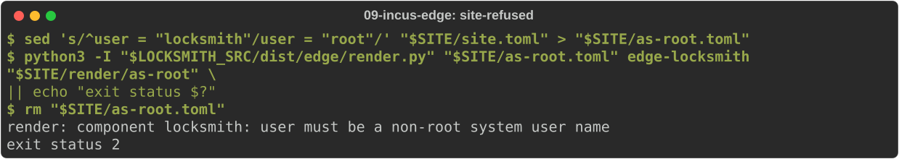
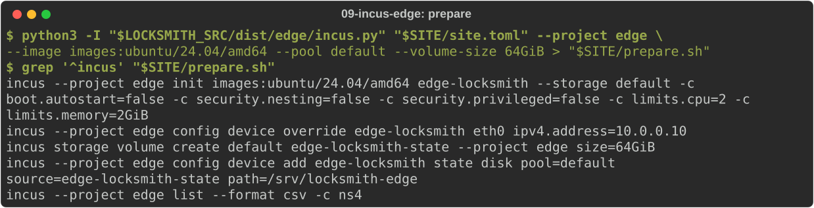
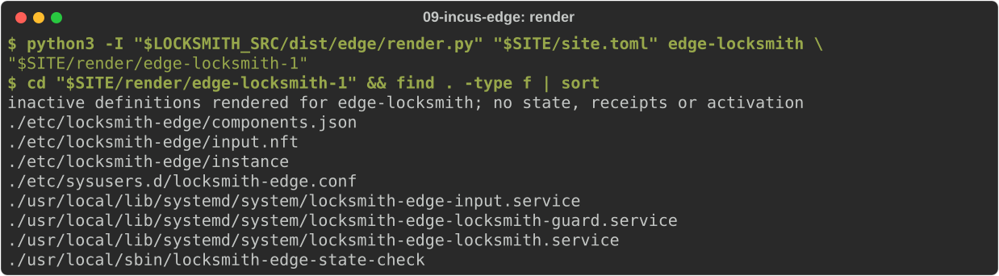
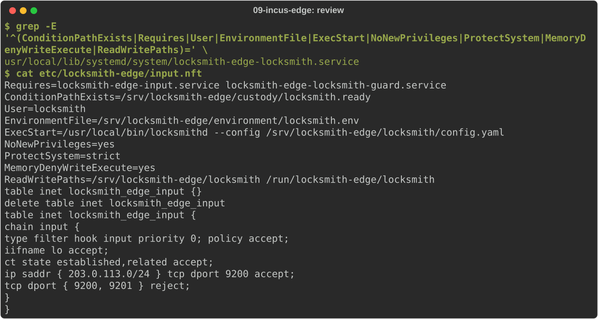

# Deploy to an Incus edge

You will run Locksmith as a hardened systemd service inside an Incus system
container. You describe the deployment in a site file, render inactive unit
definitions from it, install them with the binaries, lay out the state
volume, and start the service only after you have stated, in a custody
receipt, that its state is in place. Then you move it to a newer build and
learn how to back out.

The tools in `dist/edge/` turn the site file into reviewable Incus commands
and unit files. They never start a container or a service, and they never
handle a credential. [Edge packaging](../operator/edge-packaging.md) is the
reference for every option; this journey takes one instance through its life.

You need:

- an Incus host (`<incus-host>` below) with a project for edge containers
  (`edge` here) whose `limits.containers` you have set, and a ZFS storage
  pool (`default` here);
- a system container image that has `python3` and `findmnt`, such as
  Ubuntu 24.04 (`nft` is installed below);
- an agent-locksmith checkout at the release you deploy, in `$LOCKSMITH_SRC`,
  and Python 3.11 or later;
- `locksmith` and `locksmithd` for the container's platform, downloaded and
  checked as in [journey 1](01-install.md#install-the-binaries) or built with
  the [tested recipe](../development/build-identity.md#build-with-the-tested-recipe),
  in a directory named by `$BINS`.

Run the `incus` commands as root on the Incus host. Writing the site file
and rendering it need no privileges.

## Write the site file

The site file names the instance, its address, its limits and each service
it runs. It is specific to your deployment, so keep it in your own private
repository, never in this one. Make a directory for it:

<!-- uat:step site-dir -->
```sh
export SITE="${SITE:-$HOME/locksmith-site}"
mkdir -p "$SITE" && chmod 700 "$SITE"
```

This one runs a single Locksmith in a container named `edge-locksmith` at
`10.0.0.10` on the Incus network. Agents in `203.0.113.0/24` may reach its
agent port, 9200:

<!-- uat:step site -->
```sh
cat > "$SITE/site.toml" <<'EOF'
[site]
state_root = "/srv/locksmith-edge"
require_zfs = true

[[instance]]
name = "edge-locksmith"
address = "10.0.0.10"
cpu = 2
memory = "2GiB"

[[instance.component]]
name = "locksmith"
user = "locksmith"
command = "/usr/local/bin/locksmithd --config /srv/locksmith-edge/locksmith/config.yaml"
environment_file = true
ingress = [{ port = 9200, from = ["203.0.113.0/24"] }]
closed = [9201]
EOF
```

- `state_root` is where the instance's own state volume is mounted.
  `require_zfs` refuses to start a service unless that mount is ZFS.
- `environment_file` loads `/srv/locksmith-edge/environment/locksmith.env`,
  which will hold the sealing keys. Never put a secret in `env`: unit files
  are world-readable.
- `ingress` accepts TCP on 9200 only from the listed networks. `closed`
  rejects 9201, the admin HTTPS port, from every source, so it stays
  unreachable even if you turn it on later. Operators use `incus exec`.

The tools refuse a site file with unknown keys, duplicate names, a state
root that is not a plain absolute path, bad addresses or ports, or a service
that runs as `root` or `nobody`:

<!-- uat:step site-refused -->
```sh
sed 's/^user = "locksmith"/user = "root"/' "$SITE/site.toml" > "$SITE/as-root.toml"
python3 -I "$LOCKSMITH_SRC/dist/edge/render.py" "$SITE/as-root.toml" edge-locksmith "$SITE/render/as-root" \
  || echo "exit status $?"
rm "$SITE/as-root.toml"
```



## Prepare the container

`incus.py` prints a script that creates the container **stopped**, with
`boot.autostart=false`, no nesting and no privileged mode, and gives it its
own state volume mounted at `state_root`. It runs nothing itself:

<!-- uat:step prepare -->
```sh
python3 -I "$LOCKSMITH_SRC/dist/edge/incus.py" "$SITE/site.toml" --project edge \
  --image images:ubuntu/24.04/amd64 --pool default --volume-size 64GiB > "$SITE/prepare.sh"
grep '^incus' "$SITE/prepare.sh"
```



Review the whole script, then run it on the Incus host. It refuses a VM
image, a project whose container limit is too low, and an instance or
volume that already exists:

```sh
less "$SITE/prepare.sh"
bash "$SITE/prepare.sh"
```

## Render the definitions

Render the instance into a directory that does not exist yet:

<!-- uat:step render -->
```sh
python3 -I "$LOCKSMITH_SRC/dist/edge/render.py" "$SITE/site.toml" edge-locksmith \
  "$SITE/render/edge-locksmith-1"
cd "$SITE/render/edge-locksmith-1" && find . -type f | sort
```



The tree holds the Locksmith unit, a guard unit that runs as root before
every start, the unit that loads the ingress table, the system user, the
list of components the guard allows, and the guard itself. It has no
enabled-unit links and no receipts. Read the unit and the ingress table
before you install them:

<!-- uat:step review -->
```sh
grep -E '^(ConditionPathExists|Requires|User|EnvironmentFile|ExecStart|NoNewPrivileges|ProtectSystem|MemoryDenyWriteExecute|ReadWritePaths)=' \
  usr/local/lib/systemd/system/locksmith-edge-locksmith.service
cat etc/locksmith-edge/input.nft
```



`ConditionPathExists` keeps the service from starting until its custody
receipt exists, and `Requires` makes it wait for the guard and the ingress
table. A render never overwrites an earlier one:

<!-- uat:step render-refused -->
```sh
python3 -I "$LOCKSMITH_SRC/dist/edge/render.py" "$SITE/site.toml" edge-locksmith \
  "$SITE/render/edge-locksmith-1" || echo "exit status $?"
```

To render again, remove the old directory or pick a new name.

## Write the Locksmith configuration

The daemon's configuration lives on the state volume, beside its database.
Write it in the site directory; you copy it in below:

<!-- uat:step config -->
```sh
cat > "$SITE/config.yaml" <<'EOF'
listen:
  host: "0.0.0.0"
  port: 9200
  auth_mode: bearer
  admin_socket:
    path: "/run/locksmith-edge/locksmith/admin.sock"
operator_credentials_path: "/srv/locksmith-edge/locksmith/operators.yaml"
database:
  path: "/srv/locksmith-edge/locksmith/locksmith.db"
audit:
  retention_days: 30
egress:
  mode: external
logging:
  level: info
shutdown:
  drain_window_seconds: 30
mcp:
  allowed_hosts: ["10.0.0.10:9200", "127.0.0.1:9200"]
  allowed_origins: []
EOF
```

- The admin socket is in the service's runtime directory,
  `/run/locksmith-edge/locksmith`, one of the two places it may write.
- `egress.mode: external` sends proxied routes straight out and leaves
  egress to your network, such as the host's Incus network ACLs. Allow the
  container only the destinations its routes need. See
  [journey 10](10-egress-inspection-limits.md#choose-how-traffic-leaves).
- `mcp.allowed_hosts` names the addresses agents use to reach `/mcp/`.

## Install the definitions and binaries

Start the container. No application unit is enabled and none can start
without its receipt, so booting it is safe. Copy the rendered tree in as
root, so every file is root-owned, then the binaries and the bundled seed
catalog, which the daemon imports on its first start:

```sh
incus --project edge start edge-locksmith
tar -C "$SITE/render/edge-locksmith-1" -cf - etc usr | \
  incus --project edge exec edge-locksmith -- tar -xf - -C / --no-same-owner --no-overwrite-dir
incus --project edge file push --uid 0 --gid 0 --mode 0711 "$BINS/locksmithd" edge-locksmith/usr/local/bin/locksmithd
incus --project edge file push --uid 0 --gid 0 --mode 0755 "$BINS/locksmith" edge-locksmith/usr/local/bin/locksmith
incus --project edge exec edge-locksmith -- install -d -m 0755 /etc/locksmith/seed
incus --project edge file push --uid 0 --gid 0 --mode 0644 "$LOCKSMITH_SRC/seed/catalog.yaml" \
  edge-locksmith/etc/locksmith/seed/catalog.yaml
incus --project edge exec edge-locksmith -- sh -c 'systemd-sysusers && systemctl daemon-reload'
```

`locksmithd` must be root-owned and execute-only (`0711`). The kernel then
makes the process non-dumpable from the moment it starts, so nothing else
running as `locksmith` can read its environment or memory. The guard
refuses to start it otherwise. That holds only while the host's
`fs.suid_dumpable` sysctl is `0` or `2`; it is kernel-wide, so if the guard
refuses, set it on the Incus host and keep it across reboots:

```sh
grep -rn suid_dumpable /etc/sysctl.conf /etc/sysctl.d /usr/lib/sysctl.d
sysctl -w fs.suid_dumpable=2
echo 'fs.suid_dumpable = 2' > /etc/sysctl.d/60-locksmith-edge.conf
```

The ingress unit needs `nft` in the container, and Ubuntu images do not ship
it: without it the unit fails and no component starts. If the container can
reach a package mirror, `apt-get install -y nftables` inside it. If its
egress allows only your routes' destinations, download the packages on the
host for the container's release and push them in:

```sh
mkdir -p /root/edge-debs && cd /root/edge-debs
apt-get download libjansson4 libnftnl11 libnftables1 nftables
incus --project edge exec edge-locksmith -- install -d -m 0700 /root/debs
for f in *.deb; do
  incus --project edge file push --uid 0 --gid 0 --mode 0644 "$f" edge-locksmith/root/debs/
done
incus --project edge exec edge-locksmith -- sh -c 'dpkg -i /root/debs/*.deb && test -x /usr/sbin/nft'
```

`apt-get download` fetches the host's release; when the host runs a
different release than the container, take the container's packages from
its distribution's archive instead.

## Lay out the state volume

Inside the container, as root, mark the volume as this instance's, create
the directories the guard checks, install the configuration, generate the
sealing keys and mint an operator credential. Nothing secret is printed:

```sh
incus --project edge file push --uid 0 --gid 0 --mode 0644 "$SITE/config.yaml" edge-locksmith/root/config.yaml
incus --project edge exec edge-locksmith -- bash -euo pipefail <<'EOS'
R=/srv/locksmith-edge
umask 077
echo edge-locksmith > $R/.locksmith-edge-id
chmod 0644 $R/.locksmith-edge-id
install -d -m 0755 $R/custody
install -d -m 0700 $R/environment
install -d -m 0700 -o locksmith -g locksmith $R/locksmith $R/locksmith/home
install -m 0644 -o root -g root /root/config.yaml $R/locksmith/config.yaml
cred_key=$(head -c 32 /dev/urandom | base64 -w0)
oauth_key=$(head -c 32 /dev/urandom | base64 -w0)
[ ${#cred_key} -eq 44 ] && [ ${#oauth_key} -eq 44 ]
printf 'LOCKSMITH_CREDENTIAL_SEALING_KEY=%s\nLOCKSMITH_OAUTH_SEALING_KEY=%s\n' \
  "$cred_key" "$oauth_key" > $R/environment/locksmith.env
unset cred_key oauth_key
chmod 0600 $R/environment/locksmith.env
install -d -m 0700 /root/locksmith
/usr/local/bin/locksmith bootstrap-operator --name edge-admin \
  > $R/locksmith/operators.yaml 2> /root/locksmith/operator-token.txt
chown locksmith:locksmith $R/locksmith/operators.yaml
chmod 0600 $R/locksmith/operators.yaml
EOS
```

- `$R`, `.locksmith-edge-id`, `custody/` and `environment/` stay root-owned
  and not group- or world-writable. The service can write only
  `$R/locksmith` and its runtime directory.
- Each key is generated into a variable before it is written, so a failed
  generation stops the script under `set -e` instead of writing an empty
  key.
- Back up `locksmith.env` to your password manager before you store any
  credential: losing a sealing key loses every value sealed under it. See
  [sealed-state recovery](../operator/sealed-state-recovery.md).
- The operator token is in `/root/locksmith/operator-token.txt` in the
  container, on its `export LOCKSMITH_OP_TOKEN=` line. Keep it in your
  password manager too.

## Acknowledge custody and start

The receipt is your statement that this component's state is in place and
that no other copy of it runs anywhere. Write it only when that is true,
then enable the ingress table and the service:

```sh
incus --project edge exec edge-locksmith -- bash -euo pipefail <<'EOS'
echo edge-locksmith:locksmith > /srv/locksmith-edge/custody/locksmith.ready
chmod 0644 /srv/locksmith-edge/custody/locksmith.ready
systemctl enable --now locksmith-edge-input.service locksmith-edge-locksmith.service
systemctl --no-pager status locksmith-edge-locksmith.service | head -5
nft list table inet locksmith_edge_input
EOS
```

Before every start and restart, the guard checks that the components file
is root-owned, the state root is its own ZFS mount, the volume names this
instance, the receipt is root-owned and names `edge-locksmith:locksmith`,
and `locksmithd` is `0711` with `fs.suid_dumpable` at `0` or `2`. If any
check fails the service does not start, and the reason is in the guard's
journal:

```sh
incus --project edge exec edge-locksmith -- journalctl -u locksmith-edge-locksmith-guard --no-pager
```

## Check that it answers

The image may not have `curl`, so ask with Python from inside the container:

```sh
incus --project edge exec edge-locksmith -- python3 -I -c '
import urllib.request as u
for probe in ("readyz", "version"):
    print(probe, u.urlopen(f"http://127.0.0.1:9200/{probe}", timeout=5).read().decode())'
```

Expect `"status":"ready"` and the version you installed. From a host on the
agent network, `curl -fsS http://10.0.0.10:9200/readyz` answers too; from
anywhere else the ingress table rejects the connection.

Operators work inside the container with the token from the operators
file:

```sh
incus --project edge exec edge-locksmith -- bash -c '
eval "$(grep "export LOCKSMITH_OP_TOKEN=" /root/locksmith/operator-token.txt)"
LOCKSMITH_SOCKET=/run/locksmith-edge/locksmith/admin.sock locksmith tool list'
```

From here, connect services and enrol agents as in journeys
[2](02-http-service.md) to [8](08-operate.md).

## Move to a newer build

The database, sealing keys, operator credential and sealed credentials
carry over: the new daemon applies its embedded migrations on start. An
older daemon refuses a database a newer one has migrated, so take a whole
copy of the database first and keep the old binaries beside it.

`incus exec` reads stdin, so an exec without `</dev/null` swallows the rest
of a script fed to a remote shell. End each one with `</dev/null`, or run
them one at a time:

```sh
incus --project edge exec edge-locksmith -- systemctl stop locksmith-edge-locksmith.service </dev/null
incus --project edge exec edge-locksmith -- python3 -I -c '
import sqlite3
src = sqlite3.connect("/srv/locksmith-edge/locksmith/locksmith.db")
src.backup(sqlite3.connect("/root/locksmith/locksmith-before-upgrade.db"))' </dev/null
incus --project edge exec edge-locksmith -- cp -p /usr/local/bin/locksmithd /usr/local/bin/locksmith /root/locksmith/ </dev/null
incus --project edge file push --uid 0 --gid 0 --mode 0711 "$BINS/locksmithd" edge-locksmith/usr/local/bin/locksmithd
incus --project edge file push --uid 0 --gid 0 --mode 0755 "$BINS/locksmith" edge-locksmith/usr/local/bin/locksmith
incus --project edge file push --uid 0 --gid 0 --mode 0644 "$LOCKSMITH_SRC/seed/catalog.yaml" \
  edge-locksmith/etc/locksmith/seed/catalog.yaml
incus --project edge exec edge-locksmith -- bash -euo pipefail <<'EOS'
sha256sum /usr/local/bin/locksmithd /usr/local/bin/locksmith
systemctl start locksmith-edge-locksmith.service
python3 -I -c 'import urllib.request as u; print(u.urlopen("http://127.0.0.1:9200/version", timeout=5).read().decode())'
EOS
```

Check the hashes against the release's `SHA256SUMS`, then check that
`/version` reports the new release and your agents still work. Your routes
and agents are in the database, so nothing else needs re-entering.

To return to the old build, stop the service, put the copied binaries and
the pre-upgrade database back (removing the newer database's `-wal` and
`-shm` files), and start it again. Anything changed since the copy is lost.
There is no in-place downgrade.

## Back out

To take the instance out of service, stop and disable its units, remove
its receipt so nothing starts it again, and stop the container:

```sh
incus --project edge exec edge-locksmith -- systemctl disable --now \
  locksmith-edge-locksmith.service locksmith-edge-input.service </dev/null
incus --project edge exec edge-locksmith -- rm /srv/locksmith-edge/custody/locksmith.ready </dev/null
incus --project edge stop edge-locksmith
```

This leaves in place, on purpose:

- the state on the volume: database, keys, operator credential;
- any packages you installed in the container;
- the render directory in `$SITE/render/`.

Deleting the container and its `edge-locksmith-state` volume destroys that
state for good.

Next: decide how routes leave the host, inspect what they carry and limit
each agent, in [journey 10](10-egress-inspection-limits.md).
